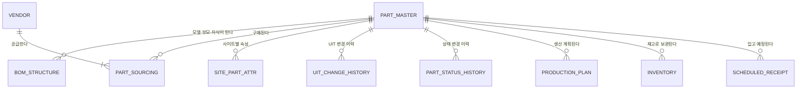

# 왜 DB를 배우나요?

:::goal
- 생산 직무가 왜 DB를 배우는지 설명할 수 있습니다.
- 데이터 모델링으로 ERD를 그리고 읽을 수 있습니다.
- 실습 데이터의 ERD·관계 모델을 읽어 낼 수 있습니다.
:::


## 1. AX란 무엇인가요?

### 1-1. DX(Digital Transformation, 디지털 전환)

DX는 새 프로그램을 들여오는 것이 아닙니다. **데이터·클라우드 같은 디지털 기술로 업무·서비스·의사결정 방식을 더 효율적이고 체계적인 구조로 바꾸는 것**입니다.

```flow DX의 흐름
download | 수집
chart-column | 분석
lightbulb | 인사이트
settings | 적용
rocket | 혁신 | | hot
```

### 1-1. 예시: 고객 리뷰·A/S 문의·사용 패턴 데이터

```icons
message-square-text | 고객 리뷰 | 별점·후기 | rose
wrench | A/S 문의 | 고장·불편 접수 | plum
activity | 사용 패턴 | 언제·얼마나 쓰는지 | lime
```

| DX 이전 | DX 이후 |
| --- | --- |
| 담당자가 고객 의견을 직접 듣고 불편함을 확인 | 의견 데이터를 저장 → 수집 → 분석 → 체계화 |
| 데이터 집계와 분석에 한계 | 분석한 데이터로 인사이트를 쉽게 만들 수 있음 |

> 데이터 → 고객 Pain Point 확인 → 제품 개선·서비스 반영 → 품질 향상 → 생산성 제고

### 1-2. AX(AI 전환)와 앞으로의 경쟁력 {keep}

AX(AI Transformation)는 ==AI를 활용해 일하는 방식 자체를 더 지능적으로 바꾸는 것==입니다.

- DX가 데이터를 잘 모으고 활용하는 **구조**를 만드는 일이라면,
- AX는 그 데이터 위에서 AI가 **분석·분류·예측·추천·자동화**까지 하도록 만드는 일입니다.
  예) AI가 리뷰를 읽고 불만 유형을 자동 분류 · 문제 원인 탐지 · 개선 기능 추천

```flow
database | DX 역량 | 데이터를 잘 모으는 힘 | lime
+
brain | AX 역량 | 데이터를 AI와 연결해 문제를 푸는 힘 | plum
=
trophy | 앞으로의 경쟁력 | | hot
```

<div class="frag" style="--i:3"><div class="table-wrap"><table><thead><tr><th>앞으로의 경쟁력</th><th>DX 역량</th><th>AX 역량</th></tr></thead><tbody><tr><td><mark>DX 역량 + AX 역량</mark></td><td>데이터를 <strong>잘 모으는</strong> 힘</td><td>데이터를 <strong>AI와 연결해</strong> 문제를 푸는 힘</td></tr></tbody></table></div></div>

### 1-3. 같은 업무, DX에서는? AX에서는?

```icons
monitor | DX | 사람이 데이터를 보고 판단합니다 | ivory
bot | AX | AI가 데이터를 보고 판단·실행합니다 | plum
```

| DX에서는 | AX에서는 |
| --- | --- |
| 고객 데이터를 CRM에 저장한다 | **AI**가 CRM 데이터로 이탈 가능 고객을 ==예측==한다 |
| 매출 대시보드를 사람이 확인한다 | **AI**가 대시보드를 보고 이상 매출 변동을 ==요약==한다 |
| SQL로 직접 조회한다 | **자연어 질문**을 SQL로 ==변환==한다 |
| 상담 기록을 검색하고 분류한다 | **AI**가 상담 내용을 ==자동으로== 요약·분류한다 |
| 제조 데이터를 모니터링한다 | **AI**가 제조 데이터로 불량 가능성을 ==예측==한다 |
| 보고서를 사람이 작성한다 | **AI**가 ==초안==을 만들고 ==검토==까지 수행한다 |

:::note 생각해 보기
엑셀이 도입되기 전에는 어떻게 일했을까요? 종이에 적고 계산기를 두드렸습니다.
지금 엑셀은 필수 기술입니다. AI도 마찬가지로, **업무에 자연스럽게 녹여 쓸 수 있어야** 합니다.
:::

### 1-4. 기업은 정말 AX로 가고 있을까요? {keep}

업종을 가리지 않고 기업들이 **AI를 도입하고 사내 AI 교육**을 하고 있습니다.

```icons
newspaper | 도입 확산 | 업종을 가리지 않는 AI 도입 | rose
building-2 | 사내 활용 | 기술블로그로 공개된 적용 사례 | plum
graduation-cap | 직원 교육 | 전 직원 대상 AI 역량 강화 | lime
```

| 출처 | 내용 | 자료 |
| --- | --- | --- |
| 언론 보도 | 업종을 가리지 않는 기업의 AI 도입 확산 | [CIO Korea — 2026년 국내 기업 85%가 생성형 AI 도입](https://www.cio.com/article/4045735) |
| 우아한형제들 기술블로그 | 사내 AI 활용 사례 — 질문을 SQL로 바꿔 데이터를 꺼내 주는 AI 분석가 | [AI 데이터 분석가 ‘물어보새’ 등장](https://techblog.woowahan.com/18144/) |
| 카카오 기술블로그 | AI 적용 사례 | [스팸 콘텐츠 대응을 위한 카카오의 LLM 도입 사례](https://tech.kakao.com/posts/626) |
| 삼성SDS | 삼성바이오로직스 × Brity Automation 업무 자동화 사례 | [생성형 AI 기반 업무 자동화 사례](https://www.samsungsds.com/kr/case-study/samsung-biologics-case-with-brity-automation.html) |
| 한국지역난방공사 | AX 전환 대비 전 직원 AI 활용 교육 | [AI 품은 현장 업무 혁신…비개발자 직원이 앱 직접 개발](https://www.thefairnews.co.kr/news/articleView.html?idxno=91208) |

### 1-5. AX 엔지니어와 DB의 관계 {keep}

**AX 엔지니어**는 현업의 문제를 이해하고, 데이터를 연결하고, AI 서비스를 만들고, 자동화 워크플로우를 구축해 실제 조직 안에서 쓰이도록 운영하는 사람입니다.

```icons AX 엔지니어가 하는 일
search | 문제 발견 | 해결 설계 | rose
database | 데이터 연결 | 이번 DB 수업 | hot
brain | LLM · RAG | 문서·DB 검색 후 답하기 | lime
workflow | 자동화 | Agent·워크플로우 | plum
shield-check | 운영 · 품질 | 보안·비용·답변 품질 | ivory
```

| # | 요구 역량 | 내용 |
| --- | --- | --- |
| 1 | 문제 발견·해결 설계 | “보고서 작성이 오래 걸려요” 같은 문제를 AI로 해결하도록 설계 |
| 2 | ==데이터·시스템 연결== | ==AI가 일하려면 데이터가 필요 → 데이터를 조회·추출해 AI와 연결 (= 이번 DB 수업)== |
| 3 | LLM과 RAG 활용 | 회사 문서·DB를 검색한 뒤 답하게 하는 방식 |
| 4 | Agent·자동화 구축 | API 호출, DB 조회, 메일 발송 같은 워크플로우 자동화 |
| 5 | 운영·보안·비용·품질 | 잘 돌아가는지, 비용은 적절한지, 잘못된 답변은 어떻게 줄일지 |

### 1-5. 자동화할 때 DB는 어디서 쓰일까요?

예시: 매일 아침 **결품 위험 부품을 찾아 구매팀에 알리는 자동화**입니다. 분홍 테두리가 DB가 쓰이는 곳입니다.

```flow 결품 위험 알림 자동화 — 이 수업 Day 3·4에서 직접 만드는 흐름
clock | 매일 08:00 | 자동 실행
database | DB 조회 | 재고·생산계획·입고예정 | hot
sparkles | AI 판단 | 결품 위험 품번 찾기 | lime
user-check | 사람 승인 | 담당자 확인 | ivory
pencil-line | DB 기록 | 판단·승인 이력 저장 | hot
mail | 메일 발송 | 구매팀 알림 | ivory
```

> ==어느 단계든 DB 조회가 들어갑니다. 데이터를 다룰 줄 알아야 AI와 연결할 수 있습니다.==

## 2. DB는 왜 필요한가요?

### 2-1. 데이터베이스란?

> 여러 데이터를 한 곳에 모아 효율적으로 저장·관리하며, ==여러 사용자가 동시에 공유하고 활용==할 수 있도록 만든 기술

다른 말로는 **여러 사용자가 ‘공유’해서 쓸 수 있도록 ‘통합’해 ‘저장’한 ‘운영’ 데이터의 집합**이라고 정의합니다.

```icons 데이터베이스를 이루는 네 단어
users | 공유 | 여러 사용자가 함께 씀 | rose
layers | 통합 | 흩어진 데이터를 한곳에 | plum
hard-drive | 저장 | 컴퓨터가 접근할 수 있게 | lime
settings | 운영 | 업무에 꼭 필요한 데이터 | ivory
```

### 2-1. 예시 ① 네이버 블로그를 쓰려면 뭐부터? {keep}

```flow
notebook-pen | 블로그를 쓰고 싶다 | | ivory
log-in | 먼저 로그인 | | lime
database | 내 회원 정보가 이미 어딘가에 저장되어 있다는 뜻 | | hot
user-plus | 언제 저장됐을까? | 바로 회원가입할 때! | plum
```

### 2-1. 예시 ② 회원가입 = 내 정보를 회사에 저장하는 것 {keep}

회원가입은 아래 같은 폼에 내 정보를 입력해서 ==네이버 회사(의 DB)에 저장==하는 일입니다.

<div class="scene">
<div class="mock frag" style="--i:0"><div class="mock-title">{{ic:user-plus}} 회원가입</div><div class="mock-fld"><span>아이디</span><b>sue0122</b></div><div class="mock-fld"><span>이름</span><b>박수현</b></div><div class="mock-fld"><span>비밀번호</span><b>••••</b></div><div class="mock-btn">가입하기</div></div>
<div class="scene-arrow frag" style="--i:1">→</div>
<div class="frag" style="--i:2"><table class="mini"><caption>{{ic:database}} 회원 테이블</caption><thead><tr><th>ID</th><th>이름</th><th>비밀번호</th></tr></thead><tbody><tr><td>jin0403</td><td>남서진</td><td>5678</td></tr><tr class="new"><td>sue0122</td><td>박수현</td><td>1234</td></tr></tbody></table></div>
</div>

### 2-1. 예시 ③ 로그인 = 저장된 정보와 비교하는 것 {keep}

로그인하면 ==입력한 정보와 회원가입 때 저장된 정보가 일치하는지== 확인합니다.

<div class="scene">
<div class="mock frag" style="--i:0"><div class="mock-title">{{ic:lock}} 로그인</div><div class="mock-fld"><span>아이디</span><b>sue0122</b></div><div class="mock-fld"><span>비밀번호</span><b>••••</b></div><div class="mock-btn">로그인</div></div>
<div class="scene-arrow frag" style="--i:1">→</div>
<div class="frag" style="--i:2"><table class="mini"><caption>{{ic:database}} DB에서 찾기</caption><thead><tr><th>ID</th><th>비밀번호</th></tr></thead><tbody><tr><td>jin0403</td><td>5678</td></tr><tr class="hit"><td>sue0122</td><td>1234</td></tr></tbody></table></div>
<div class="scene-arrow frag" style="--i:3">→</div>
<div class="scene-col">
<div class="scene-note frag" style="--i:4">일치하면</div>
<div class="mock frag" style="--i:4"><div class="mock-title">{{ic:house}} 메인 페이지</div><div class="mock-ok">{{ic:circle-check}} 박수현님, 환영합니다</div><div class="mock-chips"><span>블로그</span><span>메일</span><span>카페</span></div></div>
<div class="scene-note frag" style="--i:5">다르면</div>
<div class="mock is-bad frag" style="--i:5"><div class="mock-title">{{ic:lock}} 로그인</div><div class="mock-err">{{ic:circle-x}} 아이디 또는 비밀번호를 확인하세요</div></div>
</div>
</div>

### 2-1. 예시 ④ 필요한 데이터는 DB 안에 둡니다 {keep}

:::window DB 예시
<div class="db-demo"><span class="db-big frag" style="--i:0">{{ic:database}}</span><div><div class="frag" style="--i:1"><table class="mini"><caption>회원관리 테이블</caption><thead><tr><th>ID</th><th>이름</th><th>비밀번호</th></tr></thead><tbody><tr><td>sue0122</td><td>박수현</td><td>1234</td></tr><tr><td>jin0403</td><td>남서진</td><td>5678</td></tr></tbody></table></div><p class="frag" style="--i:2;text-align:center;margin:18px 0 0">우리는 회원 정보처럼 ==필요한 데이터들을 DB 안에 둡니다.==</p></div></div>
:::


### 2-2. 엑셀로 데이터를 관리하면 안 될까? {keep}

네이버에는 여러 서비스가 있지만, **회원관리**와 **블로그** 두 팀만 예로 들어 보겠습니다.<br> 두 팀은 각자 필요한 데이터를 **각자의 파일**로 가지고 있습니다.

<div class="tables2">
<div class="frag" style="--i:0"><table class="mini"><caption>{{ic:user-cog}} 회원관리팀 파일</caption><thead><tr><th>ID</th><th>이름</th><th>비밀번호</th></tr></thead><tbody><tr><td>sue0122</td><td>박수현</td><td>1234</td></tr><tr><td>jin0403</td><td>남서진</td><td>5678</td></tr></tbody></table></div>
<div class="frag" style="--i:1"><table class="mini"><caption>{{ic:notebook-pen}} 블로그팀 파일</caption><thead><tr><th>ID</th><th>이름</th><th>비밀번호</th></tr></thead><tbody><tr><td>sue0122</td><td>박수현</td><td>1234</td></tr><tr><td>jin0403</td><td>남서진</td><td>5678</td></tr></tbody>
<thead><tr><th>ID</th><th>글 제목</th><th>글 내용</th></tr></thead><tbody><tr><td>sue0122</td><td>[맛집 리뷰] 행복한 담벼락</td><td>오늘은 …</td></tr><tr><td>jin0403</td><td>주간일기 챌린지</td><td>..</td></tr></tbody></table></div>
</div>
<br>

- 회원관리팀: 회원을 구분할 **ID**, **이름**, 로그인할 **비밀번호**
- 블로그팀: 회원인지 알기 위한 회원정보, 누가 썼는지 알기 위한 **ID**, **글 제목**, **글 내용**

### 2-2. 엑셀로 데이터를 관리하면 안 될까? {keep}

수강생 한 명이 네이버 블로그를 쓰고 싶어서 회원가입을 했습니다. <br> 그런데 블로그에 들어가니 ==자꾸 로그인하라는 창==이 뜹니다.

```flow
user-plus | 회원가입 | 수강생이 가입 | ivory
user-cog | 회원관리팀 파일에 저장 | 여기에는 있음 | lime
notebook-pen | 블로그 접속 | | ivory
file-x | 블로그팀 파일에는 없음 | 정보가 아직 안 넘어옴 | warn
log-in | “로그인하세요” | 계속 반복 | warn
```

<p>가입 정보는 회원관리팀 파일에만 있고, ==블로그팀까지 전달되지 않았기 때문==입니다. 매 순간 회원 정보를 넘겨주기도 어렵습니다.</p>
<div class="tables2">
<div class="frag" style="--i:0"><table class="mini"><caption>{{ic:user-cog}} 회원관리팀 파일</caption><thead><tr><th>ID</th><th>이름</th><th>비밀번호</th></tr></thead><tbody>
<tr><td>sue0122</td><td>박수현</td><td>1234</td></tr>
<tr><td>jin0403</td><td>남서진</td><td>5678</td></tr>
<tr class="hit frag" data-step="99"><td>son0704</td><td>손준수</td><td>91011</td></tr>
</tbody></table></div>
<div class="frag" style="--i:1"><table class="mini"><caption>{{ic:notebook-pen}} 블로그팀 파일</caption><thead><tr><th>ID</th><th>이름</th><th>비밀번호</th></tr></thead><tbody><tr><td>sue0122</td><td>박수현</td><td>1234</td></tr><tr><td>jin0403</td><td>남서진</td><td>5678</td></tr></tbody></table></div>
</div>

### 2-2. 그럼 언제 넘겨줄까? — 매일 저녁 동기화 {keep}

```flow 그 사이에는 두 팀이 서로 다른 정보를 가지고 있습니다
sun | 업무 중 | 가입·탈퇴·수정이 쌓임 | ivory
clock | 18:00 업무 정리 | | ivory
refresh-cw | 파일 동기화 | 회원관리팀 → 블로그팀 | lime
moon | 다음 날 업무 | 다시 쌓이고, 또 동기화 | ivory
```

파일로 보관하면 저장 자체에는 문제가 없지만, 이 방식에는 세 가지 문제가 생깁니다.

- 실시간으로 동기화되지 않아 **서로 다른 정보**를 가지게 됩니다. → ==실시간 공유 불가==
- 동기화하는 과정에서 데이터가 **누락**될 수 있습니다. → ==데이터 결함==
- 같은 정보(ID 등)가 **여러 파일에 중복**됩니다. → ==데이터 중복==

### 2-2. 파일로 관리하면 무엇이 문제일까요?

```compare
file-spreadsheet | 파일 중심 관리 || database | 데이터베이스 도입 후
files | 데이터를 개별 파일 단위로 따로 관리 || database | 하나의 통합된 데이터베이스에 저장
users+file-spreadsheet | 담당자가 3명이면 같은 엑셀 파일도 3개 || users | 3명이 같은 저장소에 동시에 접근
refresh-cw-off | 한 명이 수정하면 다른 파일도 모두 수정해야 함 || circle-check | 한 사람이 수정하면 모두가 변경 내용을 확인
triangle-alert | **데이터 중복 · 불일치 · 관리 비용 증가** || trophy | ==데이터 일관성과 효율적 관리==
```

### 2-2. 파일 방식의 대표 문제 세 가지 {keep}

```icons-lg 해결: 각자 가지고 있지 말고, ==하나의 데이터베이스에 정보를 저장하자!==
refresh-cw-off | 실시간 공유 불가 | 데이터가 동기화되지 않습니다 | rose
file-x | 데이터 결함 | 동기화하는 과정에서 누락될 수 있습니다 | plum
copy | 데이터 중복 | 같은 정보가 여러 곳에 중복으로 저장됩니다 | lime
```

### 2-2. 생산 현장에 대입해 보기 {keep}

자재팀·구매팀·R&D가 **각자 품번 엑셀을 따로 관리**한다면 어떻게 될까요?

```icons 같은 품번, 엑셀은 제각각
user+file-spreadsheet | 자재팀 | 품번 엑셀 A | rose
user+file-spreadsheet | 구매팀 | 품번 엑셀 B | plum
user+file-spreadsheet | R&D | 품번 엑셀 C | lime
```

```flow 불일치는 이렇게 생깁니다 — 실습 데이터 uit_change_history에 실제로 남아 있는 기록
user+pencil-line | R&D | UIT(품목 유형)를 바꿈 | lime
file-spreadsheet | 구매팀 엑셀 | Line Type(구매 속성)은 그대로 | ivory
triangle-alert | ==불일치== | line_type_updated = 'N' | warn
triangle-alert | 자재 공급 오류 | 잘못된 방식으로 발주·공급 | warn
```

### 2-3. DB로 바꾸면 — 네이버 예시 {keep}

:::window DBMS를 통한 데이터 관리
```hub
user-cog | 회원관리팀 | left
database | DB | center
notebook-pen | 블로그팀 | right
```

<div class="tables2">
<div class="frag" style="--i:3"><table class="mini"><thead><tr><th>ID</th><th>이름</th><th>비밀번호</th></tr></thead><tbody>
<tr><td>sue0122</td><td>박수현</td><td>1234</td></tr>
<tr><td>jin0403</td><td>남서진</td><td>5678</td></tr>
<tr class="frag hit" data-step="98"><td>son0704</td><td>손준수</td><td>91011</td></tr>
</tbody></table></div>
<div class="frag" style="--i:4"><table class="mini"><thead><tr><th>ID</th><th>글 제목</th><th>글 내용</th></tr></thead><tbody><tr><td>sue0122</td><td>[맛집 리뷰] 행복한 담벼락</td><td>오늘은 …</td></tr>
<tr><td>jin0403</td><td>주간일기 챌린지</td><td>..</td></tr>
<tr class="frag hit" data-step="99"><td>son0704</td><td>[여행] 카자흐스탄 여행기</td><td>..</td></tr>
</tbody></table></div>
</div>
:::

<p style="text-align:center"> 두 팀이 같은 DB를 함께 쓰니, 회원가입하는 순간 블로그팀도 바로 그 회원을 알아봅니다. </p>

### 2-3. DB로 바꾸면 — 생산 현장 {keep}

:::window 품번 데이터를 한 DB에서 관리
```hub
package | 자재팀 | left
user+file-spreadsheet | 구매팀 | left
database | DB | center
factory | R&D | right
```

<div class="tables2">
<div class="frag" style="--i:3"><table class="mini"><caption>part_master</caption><thead><tr><th>품번</th><th>품명</th><th>UIT</th></tr></thead><tbody><tr class="new"><td>ECP39799101</td><td>컴프레서</td><td>D → G</td></tr><tr><td>MGL96663301</td><td>도어 글라스</td><td>D</td></tr></tbody></table></div>
</div>
:::

<p style="text-align:center">R&D가 UIT를 바꾸면 ==자재팀·구매팀도 같은 값을 바로 봅니다.== 엑셀을 따로 맞출 일이 없어집니다. (표의 D → G는 설명을 위한 예입니다.) </p>

### 2-3. DB는 어디서 쓰이나요?

```icons
search | 검색 | | rose
log-in | 로그인 | ID·비밀번호 비교 | plum
user-plus | 회원가입 | 중복 ID 확인 | lime
wallet | 잔액 확인 | | ivory
chart-column | 분석 · 인사이트 | DX의 핵심 | hot
```

| 활용 | 예시 |
| --- | --- |
| 조회·로직 | 검색, 로그인(저장된 ID·비밀번호와 비교), 회원가입(중복 ID 확인), 잔액 확인 |
| 분석·인사이트 (DX의 핵심) | 수집 → Extract → Transform → Load → 분석·개선을 반복 |

### 2-4. DB를 배워야 하는 이유 {keep}

:::center
```flow
database | 조회 | 데이터 꺼내기 | ivory
lightbulb | 의미 찾기 | 왜 이런 숫자가 나왔을까? | lime
trending-up | 인사이트 | 다음 행동 결정 | hot
```

과거에는 개발자·IT 전문가의 영역이었지만, 지금은 모든 산업과 직무에서 **데이터가 핵심 자산**입니다.
단순한 ‘조회’를 넘어 ==데이터에서 의미를 찾고 인사이트를 끌어내야== 진정한 데이터 기반 인재입니다.
:::

## 3. DB의 종류

### 3-1. 데이터 구조에 따른 세 가지 유형 {keep}

```icons-def 이 수업에서 다루는 것은 ==정형 데이터==입니다
table | 정형 <br> (Structured) | 저장 형식과 구조가 명확히 정해진 데이터. 행 = 한 건, 열 = 속성 | plum | 관계형 DB(RDBMS), 엑셀
braces | 반정형 <br>(Semi-Structured) | 완전히 자유롭지는 않지만 구조가 유연한 데이터 | lime | JSON, 로그 데이터
image | 비정형 <br>(Unstructured) | 정해진 구조가 아예 없는 데이터 | rose | 이미지, 영상, 음성, 자유 형식 문서, 채팅 원문
```

### 3-1. 반정형 예시 — 가전 상태 로그(JSON)

```json 가전 상태 로그
{
  "memberId": "MEMBER06",
  "deviceId": "9bc39098b3e3171ad5c5...",
  "timestamp": "2026-03-17T19:20:00+09:00",
  "response": {
    "operation": { "runState": "RUNNING" },
    "diagnosis": { "errorCode": "E_DRAIN" }
  }
}
```

- `{키: 값}` 형태의 텍스트 데이터 포맷이고, Python의 딕셔너리와 거의 같습니다.
- 로그 수집이나 key:value형 NoSQL에서 많이 씁니다.

### 3-2. 정형 DB의 종류 — 실무는 관계형 {keep}

정형 DB에는 **관계형·계층형·네트워크형**이 있지만, 실무에서는 대부분 ==관계형 DB(RDB)==를 씁니다. <br>대표 제품은 **Oracle, MySQL, PostgreSQL**입니다.

```icons
table | 관계형 | 표(테이블)와 관계 · 실무 표준 | hot
list-tree | 계층형 | 부모–자식 트리 구조 | ivory
share-2 | 네트워크형 | 여러 부모를 가질 수 있는 그물 구조 | ivory
```

```icons 대표 관계형 DB 제품
si:oracle | Oracle | 기업용 상용 DB | #F80000
si:mysql | MySQL | 웹 서비스에서 널리 쓰는 오픈소스 DB | #4479A1
si:postgresql | PostgreSQL | 이 수업에서 쓰는 DB | hot#4169E1
```

### 3-3. 엑셀도 DB일까요? 관계형 DB가 더 강력한 이유 {keep}

```compare
file-spreadsheet | 엑셀 || database | 관계형 DB (RDB)
table | 행·열 구조로 데이터 저장 || key-round | ==키(PK·FK)로 테이블 사이 관계를 관리== (5-2에서 배웁니다)
file | 파일 단위 관리 || shield-check | **제약조건으로 데이터 무결성 보장**
users | 대량 데이터·동시 사용에 약함 || users | 여러 사용자가 동시에 써도 일관성 유지
minus | — || square-terminal | **SQL로 대량 조회·집계·조인**
```

### 3-4. 우리가 쓸 DB: PostgreSQL {keep}

```icons
si:postgresql | PostgreSQL | 오픈소스 관계형 DB | #4169E1
```

- PostgreSQL도 **관계형 DB**입니다. 테이블·PK·FK·SQL·트랜잭션 개념은 Oracle과 같습니다.
- 실습 데이터셋에 PostgreSQL용 적재 스크립트(`schema_postgres.sql`)가 들어 있습니다.

### 3-4. PostgreSQL ① 개발자가 가장 많이 쓰고, 가장 쓰고 싶어 하는 DB {keep}

Stack Overflow 2025 개발자 설문(전체 응답자 기준)에서 PostgreSQL은 ==사용률·선호도 모두 1위==였습니다.

```bars Stack Overflow Developer Survey 2025 — 전체 응답자 기준
series: PostgreSQL | MySQL
unit: %
사용률 | 55.6 | 40.5
써 보고 싶다 (Desired) | 46.5 | 20.5
계속 쓰고 싶다 (Admired) | 65.5 | 43.2
```

설문 보고서는 PostgreSQL이 **2023년부터** Desired·Admired 두 항목에서 모두 가장 높았다고 적고 있습니다. DB 순위 사이트 DB-Engines도 PostgreSQL을 2017·2018·2020·2023년 「올해의 DBMS」로 선정했습니다.

### 3-4. PostgreSQL ② 같은 DB 안에서 AI용 벡터 검색까지 — pgvector {keep}

1-5에서 AX 엔지니어 역량으로 **RAG**(회사 문서·DB를 검색한 뒤 AI가 답하게 하는 방식)를 다뤘습니다. RAG는 문서를 숫자 벡터(임베딩)로 바꿔 저장하고, 질문과 ==가까운 벡터를 찾는== 검색이 필요합니다.

```flow RAG가 PostgreSQL 안에서 돌아가는 순서
file-text | 문서 | 매뉴얼·상담 기록 | ivory
binary | 임베딩 | 뜻을 숫자 벡터로 | lime
si:postgresql | 같은 DB에 저장 | 기존 테이블 옆 열에 | #4169E1
message-circle-question | 질문도 벡터로 | “세탁기 물이 안 빠져요” | ivory
target | 가까운 벡터 찾기 | pgvector | hot
sparkles | AI 답변 | 찾은 문서로 답하기 | plum
```

### 3-4. PostgreSQL ② 가까운 벡터를 찾는다는 것 {keep}

뜻이 비슷한 문서는 벡터 공간에서 **가까이 모입니다.** 질문도 벡터로 바꾸면, 그 주변의 문서를 찾는 것이 곧 검색입니다.

<figure class="vspace"><svg viewBox="0 0 560 300" role="img" aria-label="벡터 공간: 세탁기 배수, 냉장고 소음, 에어컨 필터 문서가 각각 모여 있고, 질문 벡터 주변의 세탁기 배수 문서 3개가 선택된다">
<rect x="0.5" y="0.5" width="559" height="299" rx="14" fill="#fff" stroke="#E6E0CC"/>
<g fill="#C9D863" stroke="#6E1E3B" stroke-width="1.5"><circle class="vs-pt" style="--d:0" cx="110" cy="200" r="8"/><circle class="vs-pt" style="--d:1" cx="150" cy="190" r="8"/><circle class="vs-pt" style="--d:2" cx="145" cy="228" r="8"/><circle class="vs-pt" style="--d:3" cx="92" cy="236" r="8"/><circle class="vs-pt" style="--d:4" cx="70" cy="200" r="8"/></g>
<g fill="#EAB0C8" stroke="#6E1E3B" stroke-width="1.5"><circle class="vs-pt" style="--d:5" cx="400" cy="70" r="8"/><circle class="vs-pt" style="--d:6" cx="432" cy="96" r="8"/><circle class="vs-pt" style="--d:7" cx="380" cy="104" r="8"/><circle class="vs-pt" style="--d:8" cx="424" cy="58" r="8"/></g>
<g fill="#F7F6D7" stroke="#6E1E3B" stroke-width="1.5"><circle class="vs-pt" style="--d:9" cx="440" cy="214" r="8"/><circle class="vs-pt" style="--d:10" cx="474" cy="238" r="8"/><circle class="vs-pt" style="--d:11" cx="420" cy="248" r="8"/></g>
<g font-size="14" fill="#6F5A65"><text x="48" y="276">세탁기 배수 오류 문서</text><text x="356" y="138">냉장고 소음 문서</text><text x="400" y="282">에어컨 필터 문서</text></g>
<circle class="vs-ring" cx="132" cy="210" r="46" fill="none" stroke="#6E1E3B" stroke-width="2" stroke-dasharray="6 5"/>
<g stroke="#6E1E3B" stroke-width="2"><line class="vs-line" style="--d:0" x1="178" y1="176" x2="150" y2="190"/><line class="vs-line" style="--d:1" x1="178" y1="176" x2="110" y2="200"/><line class="vs-line" style="--d:2" x1="178" y1="176" x2="145" y2="228"/></g>
<g class="vs-q"><path d="M178 162 L190 176 L178 190 L166 176 Z" fill="#6E1E3B"/><text x="198" y="160" font-size="15" font-weight="700" fill="#6E1E3B">질문: “세탁기 물이 안 빠져요”</text></g>
<g class="vs-ans"><rect x="196" y="186" width="190" height="30" rx="15" fill="#EAB0C8"/><text x="291" y="206" font-size="14" font-weight="700" fill="#6E1E3B" text-anchor="middle">가까운 문서 3건을 찾음</text></g>
</svg><figcaption>숫자 벡터를 점으로 그린 그림 — 질문(◆) 주변의 문서가 답의 재료가 됩니다</figcaption></figure>

### 3-4. PostgreSQL ② pgvector가 하는 일 {keep}

- **pgvector**는 PostgreSQL에 벡터 저장과 유사도 검색 기능을 더해 주는 오픈소스 확장입니다. 정확한 검색과 근사 검색을 모두 지원하고, 코사인·L2(유클리드)·내적 등 여러 거리 계산 방식을 제공합니다.
- 별도의 벡터 전용 DB를 두지 않고, ==기존 테이블 데이터와 임베딩을 같은 테이블에 함께 저장==할 수 있습니다. 그래서 저장·조인을 한 트랜잭션 안에서 처리하고, 두 시스템을 맞추는 동기화 작업을 줄일 수 있습니다.
- 다만 수십억 건 규모의 벡터, 매우 많은 쓰기, 대규모 멀티테넌트 필터링 같은 경우에는 벡터 전용 DB가 여전히 유리하다는 평가도 함께 있습니다.

```sql 임베딩 열이 있는 테이블에서 질문과 가까운 순서로 3건 꺼내기 (<-> = L2 거리) — 모양만 보는 예시, 실습 DB에는 없는 테이블
SELECT title
FROM repair_manual
ORDER BY embedding <-> '[0.12, -0.80, ...]'
LIMIT 3;
```

### 3-4. PostgreSQL ③ 이 수업과의 연결

- 지금 배우는 SQL(조회·조인·집계)은 그대로 쓰면서, 같은 DB에 AI용 데이터까지 담을 수 있습니다.
- 과정 뒤쪽의 AI Agent는 DB 조회를 **도구(Tool)** 로 호출합니다(1-5 자동화 예시). 관계형 데이터와 벡터 검색을 한 DB에서 다룰 수 있다는 점이 ==PostgreSQL을 쓰는 이유 중 하나==입니다.

# 개념적 모델링 · ERD

## 4. 개념적 모델링 — 데이터 모델링과 ERD

### 4-1. 데이터 모델링이란? {keep}

> **데이터 모델링** — 현실의 대상을 데이터베이스에 저장할 수 있도록 ==설계하고 구축하는 과정==

:::window 데이터 모델링
```flow 집 짓기에 빗대면 — 어떤 집이 필요한지 정하고, 밑그림 → 설계도 → 시공 순서로 짓습니다
house | 요구사항 분석 | 어떤 집이 필요한가 | ivory
drafting-compass | 개념적 모델링 | 밑그림 | rose
layout-panel-top | 논리적 모델링 | 상세 설계도 | lime
hard-hat | 물리적 모델링 | 실제 시공 | plum
house+database | 데이터베이스 | 완성된 집 | hot
```
:::

### 4-1. 단계마다 하는 일과 결과물 {keep}

```icons 왼쪽에서 오른쪽으로, 앞 단계의 결과물이 다음 단계의 재료가 됩니다
clipboard-list | 요구사항 분석 | 무엇을 관리해야 하는지 정리 | ivory | [결과물] 요구사항 · 데이터 요구사항
drafting-compass | 개념적 모델링 | 어떤 데이터를 저장할지 결정하고, 개체·속성·관계를 그림 | rose | [결과물] **ERD**
layout-panel-top | 논리적 모델링 | ERD를 DBMS가 지원하는 구조로 상세 설계 (식별자·정규화·관계 설정) | lime | [결과물] 관계 모델 (PK·FK가 표시된 설계도)
hard-hat | 물리적 모델링 | 실제 DB로 구축 (인덱스·저장 구조·SQL 작성) | plum | [결과물] 실제 테이블
```

### 4-2. 예시 ① 네이버 회원과 블로그 — 시나리오 {keep}

```flow 블로그·메일·카페를 쓰려면
pen-line+mail | 블로그·메일·카페 | 쓰고 싶다 | ivory
log-in | 로그인 | 먼저 해야 한다 | ivory
user-plus | 회원가입 | ==내 정보를 회사에 저장== | hot
```

:::center
{{ic:search}} 회사가 이 데이터로 알고 싶은 것 — ==“누가 회원이고, 어떤 회원이 어떤 글을 썼는가?”==
:::

### 4-2. 예시 ① 요구사항 분석 {keep}

```rows
- | 목적 | 요구사항 분석
user-round | 회원 관리 | 회원가입 때 입력한 ID·이름·비밀번호·생년월일·성별을 저장하고, 로그인할 때 저장된 값과 비교
pen-line | 블로그 관리 | 어떤 회원이 어떤 제목과 내용으로 글을 썼는지 관리
```

> {{ic:database}} **데이터 요구사항 분석** = 요구사항을 만족하려면 어떤 데이터를 저장하고 활용해야 하는지 정의하는 단계

### 4-2. 예시 ① 최종 데이터 요구사항 {keep}

```rows 분홍 밑줄 = 한 건을 구분하는 ID
- | 데이터 | 관리할 항목 | 왜 필요한가
user-round | 회원 | ==회원ID==, 이름, 비밀번호, 생년월일, 성별 | 로그인할 때 입력한 ID·비밀번호가 저장된 값과 같은지 확인해야 함. 이름은 겹칠 수 있어 ID로 회원을 구분
pen-line | 블로그 | ==게시글번호==, 회원정보, 글 제목, 글 내용 | 누가 쓴 글인지 알아야 함. 한 회원이 글을 여러 개 쓸 수 있어 글마다 번호가 필요
```

### 4-2. 예시 ① 생각해 보기 — 1:N {keep}

```erd 회원 한 명은 글을 여러 개, 글 하나를 쓴 사람은 한 명
회원 @user-round ; ||--o< 작성한다 ; 블로그 @pen-line
```

:::note 생각해 보기
회원 한 명은 글을 여러 개 쓸 수 있지만, 글 하나를 쓴 사람은 한 명입니다(**1:N**). 그래서 블로그 쪽에 「누가 썼는지(회원정보)」만 넣으면 둘이 이어집니다. 쇼핑몰·공장 예시처럼 중간 데이터가 따로 필요하지는 않습니다.

회원관리팀과 블로그팀이 회원 정보를 각자 파일로 들고 있으면 동기화가 안 되고 중복이 생깁니다(2-2). 그래서 회원 정보는 ==회원 한 곳에만== 두고, 블로그는 회원ID로 가져다 씁니다.
:::

### 4-2. 예시 ② LG 가전 온라인 쇼핑몰 — 시나리오 {keep}

```flow 고객이 LG 가전을 사고, 리뷰를 남깁니다
users | 고객 | 쇼핑몰에 가입 | ivory
shopping-cart | 구매 | LG 가전을 산다 | lime
star | 리뷰 | 산 상품에 평점·후기 | rose
```

:::center
{{ic:search}} 회사가 알고 싶은 것 — ==“거주지역/연령대별 어떤 상품이 잘 팔리고 고객의 반응은 어떠한가?”==
:::

### 4-2. 예시 ② 요구사항 분석 {keep}

```rows
- | 목적 | 요구사항 분석
users | 고객 관리 | 고객의 이름·성별·출생연도·가입일·거주지역을 관리
package | 상품 관리 | 상품의 상품명·카테고리·가격·출시일을 관리
shopping-cart | 구매 관리 | 어떤 고객이 어떤 상품을 언제, 어떤 채널에서, 얼마에 샀는지 관리
star | 리뷰 분석 | 어떤 고객이 어떤 상품에 리뷰를 남겼는지, 평점·내용·작성일을 관리
```

### 4-2. 예시 ② 최종 데이터 요구사항 {keep}

```rows 분홍 밑줄 = 한 건을 구분하는 ID
- | 데이터 | 관리할 항목 | 왜 필요한가
users | 고객 | ==고객ID==, 고객명, 성별, 출생연도, 가입일, 거주지역 | 거주지역·연령대에 따라 사는 상품이 달라질 수 있음
package | 상품 | ==상품ID==, 상품명, 카테고리, 가격, 출시일 | 상품별 구매 건수·리뷰 평점을 분석하려면 상품을 구분할 ID가 필요
shopping-cart | 구매 | ==구매ID==, 고객정보, 상품정보, 구매일, 구매채널, 실제구매가격 | 누가 무엇을 샀는지 고객과 상품을 함께 연결해야 함. 채널·가격 분석 가능
star | 리뷰 | ==리뷰ID==, 고객정보, 상품정보, 평점, 리뷰내용, 작성일 | 많이 팔렸지만 평점이 낮은 상품을 찾으려면 평점·내용을 저장해야 함
```

### 4-2. 예시 ② 생각해 보기 — N:M {keep}

```erd 위: 고객과 상품은 N:M → 아래: 사이에 「구매」를 두면 1:N 두 개로 풀립니다
고객 @users ; >o--o< 산다 ; 상품 @package
고객 @users ; ||--o< ; 구매 @shopping-cart ; >o--|| ; 상품 @package
```

:::note 생각해 보기
고객 한 명은 여러 상품을 사고, 상품 하나는 여러 고객이 삽니다(**N:M**). 그래서 고객과 상품 사이에 ==구매==라는 데이터가 따로 필요합니다. 이 내용은 5-4 관계 설정에서 다시 다룹니다.
:::

### 4-2. 예시 ③ 창원 가전 공장의 부품 조달 — 시나리오 {keep}

```flow 여러 협력사에서 부품을 사 와서 세탁기·냉장고를 조립합니다
building-2 | 협력사 | 발주를 받는다 | ivory
truck | 납품 | 정해진 날짜에 부품 입고 | lime
factory | 창원 공장 | 세탁기·냉장고 조립 | plum
```

:::center
{{ic:search}} 회사가 알고 싶은 것 — ==“어떤 부품을 어느 협력사에서 얼마에 사고, 언제 얼마나 들어오는가?”==
:::

### 4-2. 예시 ③ 요구사항 분석 {keep}

```rows
- | 목적 | 요구사항 분석
package | 부품 관리 | 부품의 품명·단위·품목 유형(UIT)·상태를 관리
building-2 | 협력사 관리 | 협력사의 협력사명·국가·국내 여부를 관리
wallet | 구매 조건 관리 | 어떤 부품을 어떤 협력사에서, 얼마(단가·통화)에, 며칠 걸려(리드타임), 최소 몇 개(MOQ)부터 살 수 있는지 관리
truck | 입고 예정 관리 | 어떤 부품이 어떤 협력사로부터 언제, 몇 개 들어올 예정인지, 발주번호·입고 구분과 함께 관리
```

### 4-2. 예시 ③ 최종 데이터 요구사항 {keep}

```rows 분홍 밑줄 = 한 건을 구분하는 번호
- | 데이터 | 관리할 항목 | 왜 필요한가
package | 부품 | ==품번==, 품명, 단위, 품목 유형(UIT), 상태 | 부품별 단가·입고 예정을 모아 보려면 부품을 구분할 번호가 필요
building-2 | 협력사 | ==협력사코드==, 협력사명, 국가, 국내 여부 | 국내·해외 협력사에 따라 리드타임과 통화가 달라질 수 있음
wallet | 구매 조건 | ==품번 + 협력사코드==, 부품정보, 협력사정보, 구매단가, 통화, 리드타임, 최소발주량 | 같은 부품이라도 어느 협력사에서 사느냐에 따라 단가·리드타임이 다름
truck | 입고 예정 | ==입고번호==, 부품정보, 협력사정보, 도착예정일, 수량, 발주번호, 입고 구분 | 언제 몇 개가 들어오는지 알아야 결품일을 미리 찾을 수 있음
```

### 4-2. 예시 ③ 생각해 보기 — N:M과 복합 식별자 {keep}

```erd 협력사와 부품은 N:M → 「구매 조건」이 둘을 이어 줍니다
협력사 @building-2 ; ||--|< ; 구매 조건 @wallet [*품번 (FK), *협력사코드 (FK), 구매단가, 리드타임] ; >o--|| ; 부품 @package
```

```flow 구매 조건에는 단독 ID가 없습니다
key-round | 품번 | | lime
+
key-round | 협력사코드 | | lime
=
key-square | 복합 식별자 | 두 개를 합쳐 한 행을 구분 | hot
```

### 4-2. 예시 ②·③ 비교 — 구조가 같습니다 {keep}

```rows 예시 ①은 1:N이라 연결 데이터가 없습니다
- | 역할 | 예시 ② 쇼핑몰 | 예시 ③ 공장
users | 기준이 되는 대상 1 | 고객 | 협력사
package | 기준이 되는 대상 2 | 상품 | 부품
link | N:M을 풀어 주는 연결 데이터 | ==구매== | ==구매 조건==
history | 시간에 따라 쌓이는 기록 | 리뷰 | 입고 예정
```


### 4-3. 개념적 모델링 — 현실을 데이터로 {keep}

> **개념적 모델링** <br>
— 현실 세계의 복잡한 대상들을 **추상화·단순화**해 데이터로 표현하는 과정. <br>
==어떤 데이터를 저장할지 결정==하는 단계입니다.

```flow
globe | 현실 세계 | 복잡한 대상들 | ivory
filter | 추상화 · 단순화 | 필요한 것만 남긴다 | lime
table | 데이터 | 저장할 데이터 결정 | hot
```

### 4-3. ① 개체(Entity) — 하나의 집합으로 {keep}

네이버는 우리 같은 사람들을 뭐라고 부를까요?

```flow
user-round+users | 나, 친구, 가족 … | 네이버를 쓰는 사람들 | ivory
=
id-card | 회원 | 하나의 집합 | hot
```

:::center
**개체(Entity)** — 현실 세계의 대상을 데이터로 표현하는 과정에서 ==하나의 집합으로 표현되는 것==
:::

### 4-3. ② 속성(Attribute) — 공통 특징 {keep}

회원이 가진 공통 특징 중, 우리가 **저장해야 할 특징**은 무엇일까요? 네이버가 회원가입할 때 받는 정보가 바로 그것입니다.

<div class="scene">
<div class="mock frag" style="--i:0"><div class="mock-title">{{ic:user-plus}} 회원가입</div><div class="mock-fld"><span>아이디</span><b>sue0122</b></div><div class="mock-fld"><span>비밀번호</span><b>••••</b></div><div class="mock-fld"><span>이름</span><b>박수현</b></div><div class="mock-fld"><span>생년월일</span><b>2023-01-22</b></div><div class="mock-fld"><span>성별</span><b>여</b></div></div>
<div class="scene-arrow frag" style="--i:1">→</div>
<div class="ent-box frag" style="--i:2;min-width:300px"><b>{{ic:id-card}} 회원 — 속성(Attribute)</b><div class="chips"><span>ID</span><span>비밀번호</span><span>이름</span><span>생년월일</span><span>성별</span></div></div>
</div>

### 4-3. 네이버와 창원 공장에 똑같이 적용하기 {keep}

```rows
- | 단계 | 익숙한 예: 네이버 | 생산 예: 창원 공장
message-circle-question | 질문 | ‘나’라는 사용자를 네이버는 어떻게 데이터로 저장할까? | 창고에 쌓인 ‘컴프레서’라는 실물을 공장은 어떻게 데이터로 저장할까?
id-card | ① 하나의 집합으로 표현 → **개체(Entity)** | ==회원== | ==부품==
tag | ② 공통 특징 표현 → **속성(Attribute)** | ID, 비밀번호, 이름, 생년월일, 성별 등 | 품번, 품명, 단위, 품목 유형(UIT) 등
```

### 4-3. 인스턴스 — 속성이 값을 가진 실체 {keep}

**인스턴스** — 개체를 구성하고 있는 속성이 ==값을 가져 실체화된 것==

<div class="tables2">
<table class="mini"><caption>{{ic:user-round}} 익숙한 예</caption><thead><tr><th>ID</th><th>비밀번호</th><th>이름</th><th>생년월일</th><th>성별</th><th class="lab">← 개체(속성)</th></tr></thead><tbody><tr><td>sue0122</td><td>1234</td><td>박수현</td><td>2023-01-22</td><td>여</td><td class="lab">← 인스턴스</td></tr><tr><td>jin0403</td><td>5678</td><td>남서진</td><td>2023-04-18</td><td>여</td><td class="lab">← 인스턴스</td></tr></tbody></table>
<table class="mini"><caption>{{ic:package}} 생산 예</caption><thead><tr><th>품번</th><th>품명</th><th>단위</th><th>UIT</th><th class="lab">← 개체(속성)</th></tr></thead><tbody><tr><td>ECP39799101</td><td>컴프레서</td><td>EA</td><td>D</td><td class="lab">← 인스턴스</td></tr><tr><td>MGL96663301</td><td>도어 글라스</td><td>EA</td><td>D</td><td class="lab">← 인스턴스</td></tr></tbody></table>
</div>

### 4-3. ③ 관계 — 개체와 개체 사이 {keep}

```erd 선 위의 글자가 관계 이름입니다
회원 @user-round ; ||--o< 작성한다 ; 블로그 @pen-line
부품 @package ; ||--o< 입고 예정되어 있다 ; 입고예정 @truck
```

```rows
- | 단계 | 익숙한 예: 네이버 | 생산 예: 창원 공장
link | ③ 개체 사이 관계 찾기 → **관계** | 회원이 블로그를 **작성한다** / <br> 블로그는 회원에게 **작성된다** | 부품이 입고 **예정되어 있다** / <br> 입고예정은 부품을 **대상으로 한다**
```

### 4-4. 데이터 모델을 이루는 요소 {keep}

```rows
- | 요소 | 뜻 | 예 (네이버) | 예 (창원공장)
id-card | **엔터티(Entity)** | 저장하려는 대상의 집합(명사형). 업무에 필요하고 저장할 가치가 있는 데이터의 집합 | 회원, 블로그, 카페 | 부품, 협력사, 입고예정
tag | **속성(Attribute)** | 엔터티가 가진 공통 특징 = 실제로 저장할 데이터 항목 | 이름, 글 제목 | 품명, 단위, 품목 유형
user-round | **인스턴스(Instance)** | 엔터티 안의 개별 데이터. 속성이 값을 가져 실체화된 것 | 회원 집합 속 ‘sue0122’ | 부품 집합 속 ‘컴프레서’
link~hot | ==관계(Relationship)== ⭐ | 엔터티와 엔터티 사이의 의미 있는 연결 | 회원이 블로그를 **작성한다** | 협력사가 부품을 **공급한다**
```

### 4-4. 엔터티 — 업무에 필요한 것만 {keep}

네이버라면 어떤 엔터티가 필요할까요?
```icons 
user-round | 회원 | 필요 | lime
pen-line | 블로그 | 필요 | lime
coffee | 카페 | 필요 | lime
mail | 메일 | 필요 | lime
ban | 환자 | 네이버 업무엔 필요 없음 | warn
```

엔터티가 갖춰야 할 것
- 엔터티는 2개 이상의 인스턴스, 하나 이상의 속성, 하나 이상의 관계를 가집니다.
```icons 
users | 2개 이상 | 인스턴스
tag | 1개 이상 | 속성
link | 1개 이상 | 관계
```

### 4-4. 속성 — 더 이상 나눌 수 없는 최소 단위 {keep}

가능하면 **의미상 더 이상 나눌 수 없는 최소 단위**로 나눕니다. 하나의 속성에는 하나의 값만 들어갑니다.
<br>(비밀번호가 1234와 5678 두 개일 수 없음).

```flow 「이름나이」는 두 속성으로 나눌 수 있으므로 부적절
tag | 이름나이 | 한 칸에 두 값 | warn
→
tag | 이름 | | lime
+
tag | 나이 | | lime
```

> {{ic:house}} `거주지역(주소)` → 시·군·구로 나눌 수도 있지만, 의미상 ‘주소’ 단위로도 사용 가능

### 4-4. 인스턴스 — 집합 속 하나 {keep}

```flow 반 학생 전체를 하나의 집합으로 보면
users | 학생 엔터티 | 테이블 전체 | ivory
→
user-round | 학생 한 명 | 인스턴스 = 한 행 | hot
```

<div class="tables2">
<table class="mini"><caption>네이버의 ‘회원’ 엔터티</caption><thead><tr><th>회원ID</th><th>이름</th><th>생년월일</th><th>성별</th></tr></thead><tbody><tr class="hit"><td>sue0122</td><td>박수현</td><td>2023-01-22</td><td>여</td></tr><tr><td>jin0403</td><td>남서진</td><td>2023-04-18</td><td>여</td></tr><tr><td>ho0221</td><td>송승호</td><td>2023-02-21</td><td>남</td></tr></tbody></table>
<table class="mini"><caption>창원공장의 ‘부품’ 엔터티</caption><thead><tr><th>품번</th><th>품명</th><th>단위</th><th>품목 유형</th></tr></thead><tbody><tr class="hit"><td>ECP39799101</td><td>컴프레서</td><td>EA</td><td>D</td></tr><tr><td>MGL96663301</td><td>도어 글라스</td><td>EA</td><td>D</td></tr><tr><td>MFT43979901</td><td>정수 필터</td><td>EA</td><td>G</td></tr></tbody></table>
</div>

:::center
분홍 줄 하나가 **인스턴스 하나**입니다.
:::

### 4-4. 관계 — 같은 엔터티, 다른 관계 {keep}

현업 DB는 대부분 관계형 DB이므로 엔터티 사이 관계를 잘 해석하는 것이 매우 중요합니다. 
<br>==같은 엔터티라도 무엇과 이어지느냐, 어떤 업무냐에 따라 관계가 달라집니다.==

:::cols
```rows 네이버 — 같은 [회원]이라도 서비스마다
- | 서비스 | 관계
pen-line | 블로그 | 회원이 블로그 글을 **작성한다**
coffee | 카페 | 회원이 카페에 **가입한다**
mail | 메일 | 회원이 메일을 **보낸다**
```

```rows 창원공장 — 같은 [부품]이라도 업무마다
- | 업무 | 관계
wallet | 구매 | 협력사가 부품을 **공급한다**
truck | 자재 입고 | 부품이 협력사로부터 **입고 예정된다**
layers | BOM(제품 구성) | 상위 조립품이 하위 부품을 **포함한다** (부품과 부품 사이의 관계)
```
:::


### 4-5. ERD 그리기 {keep}

> 개념적 모델링 = ==개체와 속성을 만들고, 개체들 사이의 관계를 그려내는 과정==

```flow
id-card | 개체(==E==ntity) | | rose
+
link | 관계(**R**elationship) | | lime
+
tag | 그림(==D==iagram) | | ivory
=
network | ERD | 그림으로 표현 | hot
```

**ERD(Entity Relationship Diagram)** 는 개체와 그들 사이의 관계를 그림으로 표현한 것입니다. <br> 현업 DB는 테이블이 매우 많아 모두 외울 수 없으므로, ERD를 보고 “어떤 데이터가 어디에 있고, 무엇으로 이어지는지”를 파악합니다.

### 4-5. ERD 그리는 순서 — Chen 표기법과 IE 표기법 {keep}

```rows
- | 순서 · 할 일 | Chen 표기법 | IE 표기법 (Crow's Foot)
id-card | 1 · 엔터티(개체)를 그린다 | **사각형** 안에 엔터티 이름 | **사각형** 맨 위에 엔터티 이름
tag | 2 · 속성을 그린다 | 선으로 연결한 **타원**, 식별자는 **밑줄** | 사각형 **안에 목록**, 식별자는 `PK`·`*` 등
link | 3 · 관계를 확인한다 | 두 엔터티 사이 **마름모** 안에 관계 이름 | 마름모 없이 **선**으로 잇고, 선 위에 관계 이름
hash | 4 · 관계차수를 적는다 | 선 끝에 `1`, `N`, `M` | 선 끝 기호: 1쪽 {{ic:erd-bar}}, N쪽 {{ic:erd-crow}}(까마귀발)
circle-help | 5 · 참여도를 적는다 | **이중선** = 필수, **단일선** = 선택 | 필수 {{ic:erd-bar}}(최소 1), 선택 {{ic:erd-o}}(최소 0)
```

> 7절(7-3·7-4) 실습 데이터 그림은 IE 표기법입니다. ==이 수업은 IE 표기법으로 ERD를 읽습니다.==

### 4-5. 용어 정의 — 관계차수와 참여도 {keep}

```icons 
hash | 관계차수 (Cardinality) — 최대 몇 개까지? | 한 엔터티의 인스턴스 1개가 <br> 상대 엔터티의 인스턴스 **최대 몇 개**와 관계를 맺을 수 있는지 | plum | [기호] 1:1, 1:N, N:M · 1쪽 {{ic:erd-bar}} N쪽 {{ic:erd-crow}}
circle-help | 참여도 (Optionality) — 꼭 있어야 하나? | 인스턴스들이 관계에 **반드시 참여해야 하는지**(최소 1개), <br>**참여하지 않아도 되는지**(최소 0개) | rose | [기호] 필수 {{ic:erd-bar}}(최소 1) · 선택 {{ic:erd-o}}(최소 0)
```
<p class="lead">한 줄로 기억하기: 관계차수 = 몇 개까지? · 참여도 = 꼭 있어야 하나?<br>
참여도는 <strong>선택성</strong>이라고도 하고, SQLD에서는 <strong>관계선택사양</strong>이라고도 부릅니다. 관계차수는 ==최대==, 참여도는 ==최소==를 말합니다.</p>

### 4-5. 예시 ① 익숙한 예: 회원–블로그 {keep}

<div class="tables2">
<table class="mini"><caption>{{ic:user-round}} 회원</caption><thead><tr><th>회원 ID</th><th>이름</th><th>비밀번호</th></tr></thead><tbody><tr class="hit"><td>sue0122</td><td>박수현</td><td>1234</td></tr><tr><td>jin0403</td><td>남서진</td><td>5678</td></tr><tr><td class="miss">ho0221</td><td>송승호</td><td>91011</td></tr></tbody></table>
<table class="mini"><caption>{{ic:pen-line}} 블로그</caption><thead><tr><th>ID</th><th>글 제목</th><th>글 내용</th></tr></thead><tbody><tr class="hit"><td>sue0122</td><td>[맛집 리뷰] 행복한 담벼락</td><td>오늘은 …</td></tr><tr><td>jin0403</td><td>주간일기 챌린지</td><td>..</td></tr><tr class="hit"><td>sue0122</td><td>[맛집 리뷰] 참뫼, 예술의거리 맛집</td><td>..</td></tr></tbody></table>
</div>

```erd
회원 @user-round ; ||--o< 작성 ; 블로그 @pen-line
```

### 4-5. 예시 ① 선 끝 읽기 {keep}

```erd
회원 @user-round ; ||--o< 작성 ; 블로그 @pen-line
```

```rows
- | 무엇을 | 읽은 내용
erd-crow | **관계차수** — 블로그 쪽 {{ic:erd-crow}} | `sue0122` 회원 1명이 블로그 글 2개를 썼습니다 → ==회원 1 : 블로그 N==. 반대로 글 하나에 작성자가 여러 명일 수는 없습니다.
erd-o | **참여도** — 블로그 쪽 {{ic:erd-o}} | `ho0221`처럼 블로그를 하나도 안 쓴 회원도 있을 수 있습니다.
erd-bar~rose | **참여도** — 회원 쪽 {{ic:erd-bar}} | 블로그 글은 **반드시** 회원에게 작성되어야 합니다.
```

### 4-5. 예시 ② 생산 예: 부품–입고예정 {keep}

실습 데이터 `part_master`, `scheduled_receipt`의 실제 값입니다.

<div class="tables2">
<table class="mini"><caption>{{ic:package}} 부품</caption><thead><tr><th>품번</th><th>품명</th><th>단위</th><th>UIT</th></tr></thead><tbody><tr class="hit"><td>ECP39799101</td><td>컴프레서</td><td>EA</td><td>D</td></tr><tr><td>MGL96663301</td><td>도어 글라스</td><td>EA</td><td>D</td></tr><tr><td class="miss">MFT43979901</td><td>정수 필터</td><td>EA</td><td>G</td></tr></tbody></table>
<table class="mini"><caption>{{ic:truck}} 입고예정</caption><thead><tr><th>입고번호</th><th>품번</th><th>도착예정일</th><th>수량</th></tr></thead><tbody><tr class="hit"><td>1</td><td>ECP39799101</td><td>2026-12-08</td><td>800</td></tr><tr class="hit"><td>2</td><td>ECP39799101</td><td>2026-12-15</td><td>1,600</td></tr><tr><td>3</td><td>MGL96663301</td><td>2026-12-05</td><td>1,500</td></tr></tbody></table>
</div>

```erd
부품 @package ; ||--o< 입고 예정 ; 입고예정 @truck
```

### 4-5. 예시 ② 선 끝 읽기 {keep}

```erd
부품 @package ; ||--o< 입고 예정 ; 입고예정 @truck
```

```rows
- | 무엇을 | 읽은 내용
erd-crow | **관계차수** — 입고예정 쪽 {{ic:erd-crow}} | 컴프레서(`ECP39799101`) 하나에 입고예정이 2건 → ==부품 1 : 입고예정 N==. 입고예정 1건이 여러 부품을 동시에 가리키지는 않습니다.
erd-o | **참여도** — 입고예정 쪽 {{ic:erd-o}} | 정수 필터(`MFT43979901`)처럼 입고예정이 없는 부품도 있습니다. 부품 68개 중 입고예정이 있는 부품은 5개뿐입니다.
erd-bar~rose | **참여도** — 부품 쪽 {{ic:erd-bar}} | 입고예정은 **반드시** 어떤 부품 하나를 대상으로 합니다.
```

### 4-5. ERD 표기법 ① 표기법의 종류 {keep}

```icons ERD를 그리는 방식은 하나가 아닙니다
notation-chen | Chen | 엔터티 = 사각형, 관계 = 마름모, 속성 = 타원 | ivory | [주로] 개념 모델, 교육용 (1976년 피터 첸 제안)
notation-ie | IE (정보공학, Crow's Foot) | 다(Many) 쪽을 **까마귀발**로. 선 끝 {{ic:erd-o}} 선택, {{ic:erd-bar}} 필수 | hot | [주로] 실무 설계 도구, dbdiagram.io, Mermaid, SQLD
notation-barker | Barker | 다(Many) 쪽을 까마귀발로. **실선 구간 = 필수, 점선 구간 = 선택** | ivory | [주로] 오라클 설계 도구 (리처드 바커의 CASE*Method)
```

> 사각형·타원·마름모로 그리는 방식은 **Chen**, 관계차수·참여도를 기호로 적는 방식은 **IE**입니다. 이 수업의 그림은 IE 표기법을 씁니다. SQLD에는 주로 IE와 Barker 표기법 ERD를 읽는 문제가 나옵니다.

### 4-5. ERD 표기법 ② IE 표기법의 기호 세 개 {keep}

```icons-lg
erd-o | O (원) | 0개 — 없어도 된다 | ivory | [뜻] 선택
erd-bar | 막대 | 1개 — 반드시 있다 | lime | [뜻] 필수
erd-crow | 까마귀발 | 여러 개 | rose | [뜻] 다(Many)
```

### 4-5. ERD 표기법 ③ 선 끝의 두 기호를 읽는 규칙 {keep}

선 끝에는 기호가 **두 개씩** 붙습니다. ==바깥쪽(엔터티에 붙은 것) = 최대 → 관계차수==, ==안쪽(엔터티에서 먼 것) = 최소 → 참여도==

<figure class="vspace"><svg viewBox="0 0 760 230" role="img" aria-label="A와 B 사이의 선. B쪽 끝에 안쪽 원(최소 0개)과 바깥쪽 까마귀발(최대 여러 개)이 있다">
<g class="erd-svg" style="--i:0"><rect x="20" y="70" width="120" height="70" rx="10" fill="#6E1E3B"/><text x="80" y="114" font-size="26" font-weight="800" fill="#F7F6D7" text-anchor="middle" stroke="none">A</text>
<rect x="620" y="70" width="120" height="70" rx="10" fill="#6E1E3B"/><text x="680" y="114" font-size="26" font-weight="800" fill="#F7F6D7" text-anchor="middle" stroke="none">B</text>
<path d="M140 105 H620"/></g>
<g class="erd-mk" style="--i:1" stroke="#6E1E3B" stroke-width="3" fill="none"><circle cx="560" cy="105" r="10" fill="#F7F6D7"/><path d="M590 105 L620 85 M590 105 L620 125"/></g>
<g class="erd-mk" style="--i:2"><path d="M560 92 V48" stroke="#5A6614" stroke-width="2" stroke-dasharray="4 4"/><rect x="380" y="10" width="200" height="38" rx="19" fill="#C9D863"/><text x="480" y="36" font-size="17" font-weight="700" fill="#6E1E3B" text-anchor="middle">안쪽 O = 최소 0개</text></g>
<g class="erd-mk" style="--i:3"><path d="M612 128 V170" stroke="#6E1E3B" stroke-width="2" stroke-dasharray="4 4"/><rect x="470" y="170" width="250" height="38" rx="19" fill="#EAB0C8"/><text x="595" y="196" font-size="17" font-weight="700" fill="#6E1E3B" text-anchor="middle">바깥쪽 까마귀발 = 최대 여러 개</text></g>
</svg><figcaption>→ A 하나에 B가 ==0개 이상== 연결된다</figcaption></figure>

### 4-5. ERD 표기법 ④ 선 끝 모양 네 가지 {keep}

```rows 엔터티 B가 오른쪽에 있을 때, B 쪽 끝의 모양
- | 의미 | 최소 | 최대 | 선 끝 모양
- | 0개 또는 1개 | 0 | 1 | {{erd:--o|}}
- | 정확히 1개 | 1 | 1 | {{erd:--||}}
- | 0개 이상 | 0 | 여러 개 | {{erd:--o<}}
- | 1개 이상 | 1 | 여러 개 | {{erd:--|<}}
```

### 4-5. ERD 표기법 ⑤ 선 전체로 보는 관계 유형 {keep}

```rows 왼쪽 끝 = A 쪽, 오른쪽 끝 = B 쪽
- | 관계 | 선택성 | 표기 | 읽는 법
- | 1 : 1 | 필수 | {{erd:||--||}} | A 하나에 B는 반드시 1개, B 하나에 A는 반드시 1개
- | 1 : 1 | 선택 | {{erd:||--o|}} | A 하나에 B는 0개 또는 1개
- | 1 : N | 필수 | {{erd:||--|<}} | A 하나에 B는 1개 이상
- | 1 : N | 선택 | {{erd:||--o<}} | A 하나에 B는 0개 이상
- | N : M | 필수 | {{erd:>|--|<}} | 양쪽 모두 1개 이상
- | N : M | 선택 | {{erd:>o--o<}} | 양쪽 모두 0개 이상
```

### 4-5. 문제 — 표기를 보고 관계와 선택성 맞추기 {keep}

```rows 표기를 보고 관계와 선택성을 먼저 맞혀 보세요
- | 표기 | 관계 | 선택성
- | {{erd:||--o<}} | ?1 : N | ?선택
- | {{erd:>|--|<}} | ?N : M | ?필수
- | {{erd:||--||}} | ?1 : 1 | ?필수
- | {{erd:>o--o<}} | ?N : M | ?선택
- | {{erd:||--o|}} | ?1 : 1 | ?선택
- | {{erd:||--|<}} | ?1 : N | ?필수
```

### 4-5. ERD 표기법 ⑥ 식별 관계와 비식별 관계 {keep}

> 미리 알아 둘 말: **PK** = 한 행을 구분하는 값(식별자), **FK** = 다른 표에서 빌려 온 값. 5-2에서 자세히 배웁니다.

```icons IE 표기법에서는 선의 모양으로 관계의 성격도 나타냅니다
line-solid | 식별 관계 (Identifying) — 실선 | 부모의 주식별자가 자식의 **기본키(PK)에 포함**됨. 부모 없이는 자식이 존재할 수 없는 강한 연결 | plum | [주의] 계층이 깊어질수록 자식의 PK 컬럼이 늘어나 조인·WHERE 조건이 복잡해짐
line-dashed | 비식별 관계 (Non-Identifying) — 점선 | 부모의 주식별자가 자식의 **일반 속성(FK)** 으로만 들어감. 부모와 별개로 자식을 식별할 수 있는 약한 연결 | rose | [주의] 위쪽 엔터티 속성으로 조회하려면 중간 엔터티를 거쳐 조인해야 함
```

### 4-5. ⑥ 창원공장 예시로 보기 {keep}

```erd 실선 = 식별(부모 PK가 자식 PK 안으로) · 점선 = 비식별(부모 PK가 일반 컬럼으로)
부품 @package [*품번, 품명] ; ||--o< ; 구매조건 @wallet [*품번 (FK), *협력사코드 (FK), 구매단가]
부품 ; ||..o< ; 입고예정 @truck [*입고번호, 품번 (FK), 협력사코드 (FK), 수량]
```

- **구매조건이 식별 관계인 이유**: “컴프레서를 A사에서 얼마에 사는가”는 부품과 협력사가 둘 다 있어야만 의미가 있습니다. 그래서 두 부모의 PK를 합쳐 자기 PK로 씁니다.
- **입고예정이 비식별 관계인 이유**: 입고 1건은 `입고번호`만으로 구분됩니다. 품번·협력사코드는 “어느 부품을, 어느 협력사가” 보내는지 알려 주는 일반 컬럼입니다.

### 4-5. ⑥ 세 예시에서 찾아보기 {keep}

```rows
- | 예시 | 식별 관계 (실선) | 비식별 관계 (점선)
user-round | 4-2 예시 ① 네이버 | (해당 없음) | 회원 → 블로그<br>블로그 PK: `게시글번호` / FK: `회원ID`(일반 컬럼)
shopping-cart | 4-2 예시 ② 쇼핑몰 | (해당 없음) | 고객·상품 → 구매<br>구매 PK: `구매ID` / FK: `고객ID`, `상품ID`
factory~hot | 4-2 예시 ③ 창원공장 | 부품·협력사 → 구매조건<br>PK: ==품번 + 협력사코드== (둘 다 FK이면서 PK) | 부품·협력사 → 입고예정<br>PK: `입고번호` / FK: `품번`, `협력사코드`
```

> 7-4 관계 모델 그림에서 실선과 점선이 바로 이 구분입니다. 실습 데이터의 `part_sourcing`(구매조건)·`inventory`·`site_part_attr`가 식별 관계입니다(실제 `part_sourcing`의 PK는 `part_no + vendor_code + site_code` 세 컬럼입니다). 이 표기법을 알아야 데이터 사이의 관계를 읽을 수 있습니다. 정보처리기사와 SQLD에도 자주 나옵니다.

### [실습 1-A] 개념적 모델링 — 학생·과정 {keep}

```icons A학원에서 학생 정보를 관리하는 프로그램을 만들려고 합니다
graduation-cap | 학생 | 학생ID, 이름, 과정명, 성별, 나이, 연락처 | rose | [조건] **반드시 하나의 과정**에 등록
school | 과정 | 과정ID, 과정명, 과정기간, 교육장소 | lime | [조건] 학생이 **없을 수도**, **여러 명**일 수도 있음
```

:::answer
```erd
과정 @school [*과정ID, 과정명, 기간, 장소] ; ||--o< 등록 ; 학생 @graduation-cap [*학생ID, 이름, 과정명, 성별, 나이, 연락처]
```

- 관계 유형: 과정 1 : 학생 N
- 학생 1명 기준 → 과정은 정확히 1개, 필수 (학생 한 명은 반드시 과정 하나에 등록)
- 과정 1개 기준 → 학생은 0명 이상, 선택 (예: 아직 개강하지 않은 과정은 학생이 없을 수 있음)
:::

### [실습 1-B] 개념적 모델링 — 생산라인·생산계획 {keep}

```icons 1-A와 구조가 같습니다 — 학생 ↔ 생산계획, 과정 ↔ 생산라인
calendar | 생산계획 | 계획ID, 계획일자, 모델 품번, 계획수량, 근무조 | rose | [조건] **반드시 하나의 라인**에 배정
factory | 생산라인 | 라인코드, 라인명, 사이트, 생산 제품 | lime | [조건] 계획이 **없을 수도**(정비 중), **여러 개**일 수도 있음
```

:::answer
```erd
생산라인 @factory [*라인코드, 라인명, 사이트, 생산 제품] ; ||--o< 배정 ; 생산계획 @calendar [*계획ID, 계획일자, 모델 품번, 계획수량, 근무조]
```

- 관계 유형: 생산라인 1 : 생산계획 N
- 생산계획 1건 기준 → 생산라인은 정확히 1개, 필수 (계획 하나는 반드시 라인 하나에 배정)
- 생산라인 1개 기준 → 생산계획은 0건 이상, 선택 (예: 정비 중인 라인은 계획이 없을 수 있음)
:::

### 4-6. ERD 읽는 법 — 관계명 · 관계차수 · 선택성 ⭐ {keep}

선 하나에서 ==세 가지==를 읽습니다.

```rows
- | 읽을 것 | 뜻 | 표기
tag | **관계명** | 무슨 관계인지 동사형으로 적은 것 | 구매하다, 작성되다
erd-crow | **관계차수 (Cardinality)** | 몇 대 몇으로 연결되는가 (1:1, 1:N, N:M). 프로젝트에서는 1:N이 가장 많음 | 까마귀발 {{ic:erd-crow}} = 여러 개, 막대 {{ic:erd-bar}} = 1개
erd-o | **선택성 (Optionality)** | 반드시 있어야 하는가 | 막대 {{ic:erd-bar}} = 필수(1개), 원 {{ic:erd-o}} = 선택(0개 가능)
```

### 4-6. 읽는 방향 — 내 쪽 하나를 기준으로, 상대편 끝을 읽는다 {keep}

```erd
회원 @user-round ; >o--o< 구매하다 ; 상품 @package
상품 @package ; ||--o< 작성되다 ; 리뷰 @star
```

```rows
- | 기준 | 상대편 끝 | 이렇게 읽습니다
user-round | 회원 1명 | 상품 쪽 {{ic:erd-o}} + {{ic:erd-crow}} | “회원 한 명은 상품을 ==0개 이상== 구매할 수 있다” (하나만 살 수도, 아예 안 살 수도)
package | 상품 1개 | 리뷰 쪽 {{ic:erd-o}} + {{ic:erd-crow}} | “한 상품에는 리뷰가 **여러 개 작성되거나 없을 수** 있다”
star | 리뷰 1개 | 상품 쪽 {{ic:erd-bar}} | “리뷰 하나는 ==반드시 하나의 상품==에 대해 작성된다”
```

# 논리·물리 모델링

## 5. 논리적 모델링

### 5-1. 논리적 모델링이란? {keep}

> **논리적 모델링** — ERD를 기준으로 개체들을 ==DBMS가 지원하는 데이터로 변환==하는 과정. 데이터를 구조적으로 설계하는 **상세한 설계도** 단계입니다.

```flow ERD(밑그림)를 세 가지 작업으로 상세 설계도로 바꿉니다
network | ERD | 개념적 모델 | ivory
key-round | 식별자 선택 | 5-2 | rose
scissors | 정규화 | 5-3 | lime
link | 관계 설정 | 5-4 | plum
layout-panel-top | 관계 모델 | DBMS용 설계도 | hot
```

### 5-1. 논리적 모델링 그리는 순서 (dbdiagram.io 활용) {keep}

```rows
- | 순서 | 할 일 | 설명
list | 1 | 엔터티·속성 | 필요한 엔터티와 속성을 먼저 나열
key-round | 2 | 식별자 | 각 엔터티를 구분할 식별자를 정한다
scissors | 3 | 정규화 | 중복과 이상 현상이 없도록 정규화를 고려
link | 4 | 관계 설정 | 엔터티 간 관계를 설정한다
target | 5 | 목적 고려 | 운영/분석 목적에 따라 구조를 다르게 설계할 수 있다
```

### 5-2. 식별자(Primary Key) 지정 {keep}

하나의 엔터티 속성 중에서 각 인스턴스를 식별할 수 있는 속성을 고릅니다. **식별자 — 중복되면 안 되고, 비어 있으면 안 됩니다.**

<table class="mini"><thead><tr><th class="key">ID</th><th>이름</th><th>비밀번호</th><th>생년월일</th><th>성별</th></tr></thead><tbody><tr><td class="key">sue0122</td><td class="dup">박수현</td><td class="dup">1234</td><td>2023-01-22</td><td class="dup">여</td></tr><tr><td class="key">jin0403</td><td>남서진</td><td>5678</td><td>2023-04-18</td><td class="dup">여</td></tr><tr><td class="key">ho0221</td><td>송승호</td><td>91011</td><td> </td><td>남</td></tr><tr><td class="key">sue0606</td><td class="dup">박수현</td><td class="dup">1234</td><td>2022-01-11</td><td class="dup">여</td></tr></tbody></table>

```icons Q. 회원을 유일하게 식별할 수 있는 속성은? (분홍 칸 = 겹치는 값)
user-round | 이름 | `박수현`이 중복 → 식별자 X | warn
lock | 비밀번호 · 생년월일 · 성별 | 중복 가능 → 식별자 X | warn
key-round | ID | ==중복되지 않음 → 식별자== | hot
```

### 5-2. 식별자가 없다면 — 하나 만든다 {keep}

```flow 블로그의 [회원ID, 글 제목, 글 내용]은 값이 언제든 겹칠 수 있습니다
pen-line | 회원ID · 글 제목 <br> · 글 내용 | 언제든 중복 가능 | warn
+
hash | 게시글번호 | 1, 2, 3 … 증가하는 값 | hot
=
key-round | 중복 없는 식별자 | 인조식별자 | lime
```

> {{ic:book-open}} 용어: **식별자**는 논리적 모델링에서, **키(Key)** 는 물리적 모델링에서 쓰는 말입니다.

### 5-2. 키(Key) — PK와 FK ⭐ {keep}

식별자를 실제 테이블에 적용하면 **키(Key)** 라고 부릅니다. ERD에서도 `PK`, `FK`로 표시하는 경우가 많습니다. 식별 관계·비식별 관계를 이해하려면 꼭 알아야 합니다.

```rows
- | 용어 | 뜻 | 예 (네이버) | 예 (창원공장)
key-round~hot | **PK** (Primary Key, 기본키) = 주식별자 | 한 행을 **유일하게 구분**. **중복 X, NULL X**. 테이블마다 **하나만** | 회원의 `회원ID`<br>블로그의 `게시글번호` | 부품의 `품번`<br>협력사의 `협력사코드`
link~rose | **FK** (Foreign Key, 외래키) = 외부식별자 | 다른 테이블의 PK를 **빌려 와서** 두 테이블을 잇는 컬럼. 상대 PK에 실제로 있는 값이어야 함(참조 무결성) | 블로그의 `회원ID` → 회원의 `회원ID` | 입고예정의 `품번` → 부품의 `품번`
key-square | **복합키** = 복합식별자 | **두 개 이상의 컬럼을 묶어서** 만든 PK | (해당 없음) | 구매조건의 `품번 + 협력사코드`
hash | **인조식별자** | 업무에서 생긴 값이 아니라 구분하려고 **일부러 만든** 식별자 | 블로그의 `게시글번호` | 입고예정의 `입고번호`
```

### 5-2. 부모와 자식 — FK가 어디에 들어가나요? {keep}

PK를 빌려주는 쪽이 **부모**, FK로 받아 가는 쪽이 **자식**입니다.

```erd 위: FK가 자식의 일반 컬럼 → 비식별(점선) · 아래: FK가 자식 PK의 일부 → 식별(실선)
회원 @user-round [*회원ID, 이름] ; ||..o< 작성 ; 블로그 @pen-line [*게시글번호, 회원ID (FK), 글 제목]
부품 @package [*품번, 품명] ; ||--o< ; 구매조건 @wallet [*품번 (FK), *협력사코드 (FK), 구매단가]
```

### 5-3. 정규화(Normalization) {keep}

> **정규화** — 데이터의 ==중복을 줄이고 무결성을 유지==하기 위해 엔터티를 적절히 쪼개는 작업

```flow
table | 한 표에 다 넣은 데이터 | 같은 값이 여러 번 반복 | warn
scissors | 쪼개기 | 관심사별로 나눈다 | lime
layers | 정규화된 엔터티들 | 중복 ↓ 무결성 ↑ | hot
```

### 5-3. 정규화하지 않으면 — 이상 현상 {keep}

데이터를 삽입·수정·삭제할 때 **이상 현상(변경 이상, Modification Anomaly)** 이 생길 수 있습니다.

```icons
circle-plus | 삽입 이상 | 입력 시 불필요한 데이터가 함께 입력되거나, 별도 사실이 생기기 전까지 원하는 데이터를 넣을 수 없는 현상 | warn
pencil | 수정(갱신) 이상 | 수정 시 일부만 바뀌어 데이터가 불일치하게 되는 현상 | warn
trash-2 | 삭제 이상 | 삭제 시 유지되어야 할 데이터까지 함께 삭제되는 현상 | warn
```

```flow
triangle-alert | 믿을 수 없는 데이터 | | warn
chart-column | 데이터 품질 저하 | | warn
ban | 활용이 어려워짐 | | warn
```

### 5-3. 정규화 예시 A — 연락처·주소가 여러 개인 회원 {keep}

<div class="scene">
<div class="mock frag" style="--i:0;width:520px"><div class="mock-title">{{ic:id-card}} 회원 정보</div><div class="mock-fld"><span>회원ID</span><b>sue0122</b></div><div class="mock-fld"><span>비밀번호</span><b>1234</b></div><div class="mock-fld"><span>이름</span><b>박수현</b></div><div class="mock-fld"><span>성별 · 나이</span><b>여 · 24</b></div><div class="mock-fld"><span>연락처</span><b>집전화 02-123-4567<br>핸드폰 010-1111-1111</b></div><div class="mock-fld"><span>주소</span><b>집주소 영등포구<br>회사주소 마포구</b></div></div>
<div class="scene-arrow frag" style="--i:1">→</div>
<div class="frag" style="--i:2;max-width:330px;text-align:left">연락처 <b>2개</b> × 주소 <b>2개</b><br>= 한 표에 넣으면 ==같은 회원 정보가 4줄==로 반복됩니다.</div>
</div>

### 5-3. 예시 A ① 한 표에 모두 넣으면 {keep}

:::window 논리적 모델링
<p class="norm-h">정규화 진행</p>
<table class="mini"><thead><tr><th>회원ID</th><th>PW</th><th>이름</th><th>성별</th><th>나이</th><th>연락처</th><th>주소</th></tr></thead><tbody><tr><td>sue0122</td><td>1234</td><td>박수현</td><td>여</td><td>24</td><td>02-123-4567</td><td>영등포구</td></tr><tr><td class="dup">sue0122</td><td class="dup">1234</td><td class="dup">박수현</td><td class="dup">여</td><td class="dup">24</td><td>02-123-4567</td><td>마포구</td></tr><tr><td class="dup">sue0122</td><td class="dup">1234</td><td class="dup">박수현</td><td class="dup">여</td><td class="dup">24</td><td>010-1111-1111</td><td>영등포구</td></tr><tr><td class="dup">sue0122</td><td class="dup">1234</td><td class="dup">박수현</td><td class="dup">여</td><td class="dup">24</td><td>010-1111-1111</td><td>마포구</td></tr></tbody></table>
:::

분홍 칸은 같은 회원 정보가 ==반복 저장된 곳==입니다. 네 줄 중 한두 줄만 수정되면 수정 이상이 생깁니다.

### 5-3. 예시 A ② 회원 정보와 연락처·주소를 떼어 보면 {keep}

:::window 논리적 모델링
<p class="norm-h">정규화 진행</p>
<div class="norm-two"><table class="mini"><thead><tr><th>회원ID</th><th>PW</th><th>이름</th><th>성별</th><th>나이</th></tr></thead><tbody><tr><td>sue0122</td><td>1234</td><td>박수현</td><td>여</td><td>24</td></tr><tr><td class="dup">sue0122</td><td class="dup">1234</td><td class="dup">박수현</td><td class="dup">여</td><td class="dup">24</td></tr><tr><td class="dup">sue0122</td><td class="dup">1234</td><td class="dup">박수현</td><td class="dup">여</td><td class="dup">24</td></tr><tr><td class="dup">sue0122</td><td class="dup">1234</td><td class="dup">박수현</td><td class="dup">여</td><td class="dup">24</td></tr></tbody></table>
<table class="mini"><thead><tr><th>연락처</th><th>주소</th></tr></thead><tbody><tr><td>02-123-4567</td><td>영등포구</td></tr><tr><td>02-123-4567</td><td>마포구</td></tr><tr><td>010-1111-1111</td><td>영등포구</td></tr><tr><td>010-1111-1111</td><td>마포구</td></tr></tbody></table></div>
:::

### 5-3. 예시 A ③ 반복된 줄을 지우면 {keep}

:::window 논리적 모델링
<p class="norm-h">정규화 진행</p>
<div class="norm-two"><table class="mini"><thead><tr><th>회원ID</th><th>PW</th><th>이름</th><th>성별</th><th>나이</th></tr></thead><tbody><tr class="new"><td>sue0122</td><td>1234</td><td>박수현</td><td>여</td><td>24</td></tr></tbody></table>
<table class="mini"><thead><tr><th>연락처</th><th>주소</th></tr></thead><tbody><tr><td>02-123-4567</td><td>영등포구</td></tr><tr><td>02-123-4567</td><td>마포구</td></tr><tr><td>010-1111-1111</td><td>영등포구</td></tr><tr><td>010-1111-1111</td><td>마포구</td></tr></tbody></table></div>
:::

회원 정보는 ==한 줄만== 남았습니다. 그런데 연락처와 주소는 서로 관계가 없는데 한 줄에 묶여 있어 4줄이 그대로입니다. 한 번 더 나눕니다.

### 5-3. 예시 A ④ 정규화 완료 — 세 엔터티로 {keep}

:::window 논리적 모델링
<p class="norm-h">정규화 완료 이후 모습</p>
<div class="norm"><div class="norm-ent frag" style="--i:0"><b>회원</b><table class="mini"><thead><tr><th>회원ID</th><th>PW</th><th>이름</th><th>성별</th><th>나이</th></tr></thead><tbody><tr><td>sue0122</td><td>1234</td><td>박수현</td><td>여</td><td>24</td></tr></tbody></table></div>
<div class="norm-two"><div class="norm-ent frag" style="--i:1"><b>회원 연락처</b><table class="mini"><thead><tr><th>연락처</th></tr></thead><tbody><tr><td>02-123-4567</td></tr><tr><td>010-1111-1111</td></tr></tbody></table></div><div class="norm-ent frag" style="--i:2"><b>회원 주소</b><table class="mini"><thead><tr><th>주소</th></tr></thead><tbody><tr><td>영등포구</td></tr><tr><td>마포구</td></tr></tbody></table></div></div></div>
:::

정규화하면 ==회원 / 회원 연락처 / 회원 주소== 세 엔터티로 나뉩니다.


### 5-4. 관계 설정(Foreign Key) {keep}

> 정규화로 쪼개진 대상들을 다시 연결하기 위해 ==식별자를 빌려오는 것==

:::window 논리적 모델링
<div class="norm"><div class="norm-ent frag" style="--i:0"><b>회원</b><table class="mini"><thead><tr><th class="key">회원ID</th><th>PW</th><th>이름</th><th>성별</th><th>나이</th></tr></thead><tbody><tr><td class="key">sue0122</td><td>1234</td><td>박수현</td><td>여</td><td>24</td></tr></tbody></table></div>
<div class="norm-two"><div class="norm-ent frag" style="--i:1"><b>회원 연락처</b><table class="mini"><thead><tr><th class="new">회원ID</th><th>연락처</th></tr></thead><tbody><tr><td class="fk">sue0122</td><td>02-123-4567</td></tr><tr><td class="fk">sue0122</td><td>010-1111-1111</td></tr></tbody></table></div><div class="norm-ent frag" style="--i:2"><b>회원 주소</b><table class="mini"><thead><tr><th class="new">회원ID</th><th>주소</th></tr></thead><tbody><tr><td class="fk">sue0122</td><td>영등포구</td></tr><tr><td class="fk">sue0122</td><td>마포구</td></tr></tbody></table></div></div></div>
:::

분홍 칸 = 회원에게서 ==빌려 온 식별자(FK)==

### 5-4. 연락처 1개만 꺼내려면? — 구분코드 {keep}

:::quiz
Q. 회원 연락처에서 `sue0122`의 연락처 **1개만** 가져올 수 있을까요?
A. 어떤 연락처인지 구분할 방법이 없어 어렵습니다. 그래서 ==구분코드==를 둡니다.
:::

<div class="norm-two">
<div class="norm-ent frag" style="--i:0"><b>회원 연락처</b><table class="mini"><thead><tr><th>회원ID</th><th class="new">구분코드</th><th>연락처</th></tr></thead><tbody><tr><td>sue0122</td><td class="new">집전화</td><td>02-123-4567</td></tr><tr><td>sue0122</td><td class="new">핸드폰</td><td>010-1111-1111</td></tr></tbody></table></div>
<div class="norm-ent frag" style="--i:1"><b>회원 주소</b><table class="mini"><thead><tr><th>회원ID</th><th class="new">구분코드</th><th>주소</th></tr></thead><tbody><tr><td>sue0122</td><td class="new">집주소</td><td>영등포구</td></tr><tr><td>sue0122</td><td class="new">회사주소</td><td>마포구</td></tr></tbody></table></div>
</div>

### 5-4. 관계 설정 규칙 ① 1:N 관계 {keep}

**1:N 관계** → ==N(다) 쪽 엔터티에 1쪽의 식별자를 빌려줘서== 연결합니다(FK).

```erd
PRODUCT @package [*PRODUCT_ID, PRODUCT_NAME, PRICE] ; ||..o< 가진다 ; PRODUCT_IMAGE @image [*PRODUCT_IMAGE_ID, PRODUCT_ID (FK), IMAGE_URL]
```

### 5-4. 규칙 ① 데이터로 확인하기 — PRODUCT_ID가 2인 상품의 이미지는? {keep}

<div class="scene">
<div class="frag"><table class="mini"><caption>{{ic:package}} PRODUCT (1쪽)</caption><thead><tr><th class="key">PRODUCT_ID</th><th>PRODUCT_NAME</th></tr></thead><tbody><tr><td>1</td><td>LG 그램 2026</td></tr><tr class="hit"><td>2</td><td>LG 휘센 에어컨</td></tr><tr><td>3</td><td>LG 양문형 냉장고</td></tr></tbody></table></div>
<div class="scene-arrow frag" style="text-align:center;font-size:1em">→<br><span style="font-size:.7em">PRODUCT_ID = 2</span></div>
<div class="frag"><table class="mini"><caption>{{ic:image}} PRODUCT_IMAGE (N쪽)</caption><thead><tr><th>PRODUCT_<br>IMAGE_ID</th><th class="new">PRODUCT_ID<br>(FK)</th><th>IMAGE_URL</th></tr></thead><tbody><tr><td>1</td><td>1</td><td>gram_1.png</td></tr><tr class="hit"><td>2</td><td>2</td><td>aircon_1.png</td></tr><tr class="hit"><td>3</td><td>2</td><td>aircon_2.png</td></tr><tr class="hit"><td>4</td><td>2</td><td>aircon_3.png</td></tr><tr><td>5</td><td>3</td><td>fridge_1.png</td></tr></tbody></table></div>
</div>

<p class="lead frag">PRODUCT_IMAGE에서 <mark>PRODUCT_ID = 2인 행</mark>을 찾으면 됩니다 → 이미지 <strong>3장</strong></p>

### 5-4. 관계 설정 규칙 ② N:M 관계 {keep}

**N:M 관계** → 반드시 1:N, N:1로 분해합니다. ==중간 엔터티를 추가==하고, 이름은 관계명을 따릅니다.

```erd 위: 회원 N : M 상품 → 아래: 회원 1 : N 구매 N : 1 상품 (구매가 회원ID, 상품ID를 모두 가짐)
회원 @user-round ; >o--o< 구매한다 ; 상품 @package
회원 @user-round [*회원ID] ; ||..o< ; 구매 @shopping-cart [*구매ID, 회원ID (FK), 상품ID (FK)] ; >o..|| ; 상품 @package [*상품ID]
```

> {{ic:lightbulb}} **ERD를 읽는 요령: ==FK가 있는 쪽이 N(여러 개)쪽==입니다.**

### 5-5. ERD → 관계 모델로 변환 {keep}

```erd 회원의 식별자(회원ID)를 연락처·주소·블로그가 빌려 갑니다
회원 @user-round [*회원ID, PW, 이름, 성별, 나이] ; ||--o< ; 회원 연락처 [회원ID (FK), 구분코드, 연락처]
회원 ; ||--o< ; 회원 주소 [회원ID (FK), 구분코드, 주소]
회원 ; ||..o< ; 블로그 [*게시글번호, 회원ID (FK), 글 제목, 글 내용]
```

> 논리적 모델은 설계할 때만 쓰는 것이 아닙니다. 개발·유지보수할 때도 이 설계도를 보고 데이터를 어떻게 다룰지 결정합니다. 그래서 ==설계도에서 데이터 간 관계를 읽을 줄 알아야== 합니다.

### 5-6. 잠깐! AI를 적극 활용하세요 {keep}

```flow 문법 암기보다 AI 초안을 이해·검증·수정하는 능력이 더 중요해지고 있습니다
bot | AI가 초안 | ERD · 관계 모델 | ivory
search | 이해 · 검증 | 요구사항에 맞나? | lime
pencil | 수정 | 직접 고친다 | rose
circle-check | 설명할 수 있다 | 무엇을 왜 만들었나 | hot
```

```text 프롬프트 예시
우리가 데이터 요구사항으로 정리한 정보를 바탕으로,
IE표기법을 활용해서 ERD(개념적 모델링)와 관계모델(논리적 모델링)을 그려줘
```

> 단, AI 결과를 그대로 쓰지 말고 ==직접 읽고 해석하며 요구사항에 맞는지 검토==해야 합니다.

### [실습 2] 논리적 모델링 — 직원·부서 {keep}

```icons A회사에서 직원 정보를 관리하는 프로그램을 만들려고 합니다
user-cog | 직원 | 직원ID, 이름, 성별, 나이, 연락처, 주소, 부서ID | rose | [조건] ==연락처·주소는 한 명이 여러 개== · **반드시 하나의 부서**에 등록
building-2 | 부서 | 부서ID, 부서명, 근무지 | lime | [조건] 직원이 **없을 수도**, **여러 명**일 수도 있음
```

1. 위 조건을 5-6의 프롬프트에 붙여 AI에게 ERD·관계 모델을 그리게 합니다.
2. 결과가 조건과 맞는지 선 끝 기호와 FK를 직접 읽어 검토합니다.

:::answer
```erd
직원 @user-cog [*직원ID, 이름, 성별, 나이, 부서ID (FK)] ; >o..|| 소속 ; 부서 @building-2 [*부서ID, 부서명, 근무지]
직원 ; ||--o< ; 직원 연락처 [직원ID (FK), 구분코드, 연락처]
직원 ; ||--o< ; 직원 주소 [직원ID (FK), 구분코드, 주소]
```
:::

:::teacher 강사 확인
- 예시 답안은 앞의 프롬프트로 AI에게 그리게 한 뒤, 결과가 맞는지 함께 검토하는 순서로 진행하세요.
- 원본 PPT 그림에는 직원 엔터티 안에도 `연락처`·`주소`가 남아 있습니다. 정규화로 별도 엔터티를 만들었으므로 직원 엔터티에서 빼는 것이 취지에 맞는지 수업 전에 확인하세요.
:::

## 6. 물리적 모델링

### 6-1. 물리적 모델링 — 실제 DB로 짓기 {keep}

> **물리적 모델링** — 논리적 모델링 결과를 가지고 ==실제 데이터베이스로 구축==하는 것

```flow
layout-panel-top | 관계 모델 | 논리적 설계도 | ivory
square-terminal | SQL 작성 · 실행 | CREATE TABLE … | lime
database | 실제 DB | 테이블이 생긴다 | hot
```

```icons 하드웨어나 운영체제의 특성을 고려해 물리적 구조를 설계합니다
search | 인덱스 구조 | 빨리 찾게 | rose
hard-drive | 내부 저장 구조 | 어떻게 담을지 | plum
waypoints | 접근 경로 | 어떤 길로 읽을지 | lime
```

이 수업의 `schema_postgres.sql`이 바로 ==물리적 모델링의 결과물==입니다.

### 6-2. 용어 정리 — 단계마다 부르는 이름 {keep}

```rows 같은 것을 단계마다 다르게 부릅니다
- | 개념적 모델링 | 논리적 모델링 | 물리적 모델링(실제 DB)
id-card | 개체(Entity) | 릴레이션(Relation) | ==테이블(Table)==
tag | 속성(Attribute) | 속성(Attribute) | ==열(Column)==
user-round | 인스턴스(Instance) | 튜플(Tuple) | ==행(Row)==
key-round | 식별자(Identifier) | 식별자 | ==키(Key)==
```

## 7. 실습 데이터 세계관과 ERD

### 7-1. 세계관 {keep}

```icons
factory | 공장 | 창원(CW) 가전 조립 라인 | plum
washing-machine | LINE-A | 세탁기 (WM-F1) | rose
refrigerator | LINE-B | 냉장고 (RF-H1) | lime
```

```stats 규모
package | 68 | 부품
list-tree | 82 | BOM 라인
building-2 | 12 | 업체
wallet | 52 | 소싱
calendar | 20 | 생산계획
warehouse | 53 | 재고
truck | 6 | 입고예정
book-open | 7 | 코드표
```

> {{ic:triangle-alert}} 모든 품번·업체·단가·수량은 **가상 데이터**이며 실제 LG 데이터와 무관합니다. 개념 구조만 LG전자 생산기술원 BOM 교육자료를 모방했습니다.

### 7-2. 테이블 한눈에 보기 {keep}

```rows
- | 그룹 | 테이블 | 한 줄 설명
database | 마스터 | `part_master`, `vendor` | 품목, 협력사
book-open | 코드표 | `code_uit`, `code_uom`, `code_status`, `code_supply_type`, `code_line_type`, `code_svc`, `code_cosp` | 코드 → 의미(영/한)
list-tree | BOM·소싱 | `bom_structure`, `part_sourcing`, `site_part_attr` | 다단계 BOM, 구매 속성·단가, 사이트별 관리속성
calendar | 계획·재고 | `production_plan`, `inventory`, `scheduled_receipt` | 12/1~12/14 생산계획, 11/30 기준 재고, 입고 예정
history | 이력 | `uit_change_history`, `part_status_history` | UIT 변경 이력, 상태 변경 이력
```

### 7-2. 실습 데이터 구조 ① part_master를 가운데 두고 {keep}

```erd part_master에서 뻗어 나가는 테이블 — 선 위 글자가 FK 컬럼, 실선 = 식별 관계 · 점선 = 비식별 관계
part_master (품목) @package [*part_no (품번), description_kr (한글 품명), uit (품목 유형) (FK), status_code (상태) (FK)] ; ||..o< model·parent·child ; bom_structure (BOM) @list-tree [*bom_id (BOM 행 번호), model_part_no (모델 품번) (FK), parent_part_no (부모 품번) (FK), child_part_no (자식 품번) (FK), qty_per (부모 1개당 소요량)]
part_master (품목) @package ; ||--o< part_no ; part_sourcing (소싱) @wallet [*part_no (품번) (FK), *vendor_code (업체 코드) (FK), *site_code (사이트 코드), po_price (구매 단가)]
part_master (품목) @package ; ||--o< part_no ; site_part_attr (사이트 속성) @factory [*site_code (사이트 코드), *part_no (품번) (FK), site_name (사이트 이름)]
part_master (품목) @package ; ||..o< part_no ; uit_change_history (UIT 이력) @history [*change_id (변경 번호), part_no (품번) (FK), old_uit (바뀌기 전 UIT), new_uit (바뀐 뒤 UIT)]
part_master (품목) @package ; ||..o< model_part_no ; production_plan (생산계획) @calendar [*plan_id (계획 번호), model_part_no (모델 품번) (FK), plan_qty (계획 수량)]
part_master (품목) @package ; ||--o< part_no ; inventory (재고) @warehouse [*site_code (사이트 코드), *part_no (품번) (FK), *location (보관 위치), on_hand_qty (현재 재고 수량)]
part_master (품목) @package ; ||..o< part_no ; scheduled_receipt (입고예정) @truck [*receipt_id (입고 번호), part_no (품번) (FK), eta_date (도착 예정일), qty (입고 수량)]
part_master (품목) @package ; ||..o< part_no ; part_status_history (상태 이력) @history [part_no (품번 · PK 없음) (FK), old_status (바뀌기 전 상태), new_status (바뀐 뒤 상태)]
```

### 7-2. 실습 데이터 구조 ② 업체와 코드표 {keep}

```erd part_master를 거치지 않고 잇는 키
vendor (업체) @building-2 [*vendor_code (업체 코드), vendor_name (업체명), country (국가)] ; ||--|< vendor_code ; part_sourcing (소싱) @wallet [*part_no (품번) (FK), *vendor_code (업체 코드) (FK), *site_code (사이트 코드)] ; >o--|| part_no ; part_master (품목) @package [*part_no (품번)]
code_uit (UIT 코드표) @tag [*uit (품목 유형), meaning_kr (한글 의미)] ; ||..o< uit ; part_master (품목) @package [*part_no (품번), uit (품목 유형) (FK), status_code (상태) (FK)] ; >o..|| status_code ; code_status (상태 코드표) @circle-check [*status_code (상태 코드), status_name (상태 이름)]
code_supply_type (공급 방식 코드표) @truck [*supply_type (공급 방식), meaning_kr (한글 의미)] ; ||..|< supply_type ; bom_structure (BOM) @list-tree [*bom_id (BOM 행 번호), supply_type (공급 방식) (FK), c_osp_flag (유상사급 여부) (FK)] ; >o..|| c_osp_flag ; code_cosp (유상사급 코드표) @book-open [*c_osp_flag (유상사급 여부)]
```

### 7-3. 개념 ERD — 무엇과 무엇이 이어져 있나? {keep}

4절에서 배운 **개념적 모델링** 수준의 그림입니다. 테이블(개체)과 관계만 보여 주고, 코드표 7개는 그림을 단순하게 하려고 뺐습니다(7-4 관계 모델에는 모두 있습니다).



### 7-3. 개념 ERD 읽는 법 {keep}

```hub 품번(part_no) 하나로 모두 이어집니다
list-tree | BOM | left
wallet | 소싱 | left
history | 이력 | left
package | PART_MASTER | center
calendar | 생산계획 | right
warehouse | 재고 | right
truck | 입고예정 | right
```

```rows
- | 읽을 곳 | 뜻
package~hot | 한가운데 `PART_MASTER` | BOM·소싱·재고·생산계획·입고예정·이력이 모두 ==품번==(`part_no`)으로 이어집니다
erd-crow | 선 끝 기호 | {{erd:--||}} 반드시 하나 · {{erd:--o<}} 0개 이상 · {{erd:--|<}} 1개 이상 (4-5 ERD 표기법과 같은 뜻)
line-solid | 모두 실선 | 개념 ERD는 식별·비식별을 구분하지 않았습니다. 구분은 7-4 관계 모델에서 봅니다
triangle-alert~warn | 빠진 선 | `scheduled_receipt.vendor_code`는 협력사 코드지만 `REFERENCES`가 없어 선을 뺐습니다
```

### 7-4. 관계 모델 — 어떤 컬럼으로 이어져 있나? {keep}

5절 **논리적 모델링**의 결과에 해당하는 그림입니다. ==실선 = 식별 관계==(`part_sourcing`, `site_part_attr`, `inventory`), ==점선 = 비식별 관계==입니다. 코드표 7개는 PK 컬럼만, 나머지 10개 테이블은 모든 컬럼을 표시했습니다. 선 위의 글자는 FK 컬럼 이름입니다.

```mermaid 실습 데이터 관계 모델 (테이블 17개)
erDiagram
    PART_MASTER {
        char part_no PK "품번 11자리"
        text description "영문 명칭"
        text description_kr "한글 명칭"
        char class_lv1 "분류 1"
        char class_lv2 "분류 2"
        text tech_spec "기술 사양"
        char uom FK "단위"
        char uit FK "품목 유형"
        smallint status_code FK "상태"
        char svc_code FK "서비스 구분 (NULL 가능)"
        text svc_location_no "서비스 위치번호"
        date created_at "등록일"
    }
    BOM_STRUCTURE {
        int bom_id PK
        char model_part_no FK "모델(세트) 품번"
        char parent_part_no FK "부모 품번"
        char child_part_no FK "자식 품번"
        smallint bom_level "BOM 레벨"
        numeric qty_per "부모 1개당 소요량"
        char uom "단위 (FK 제약 없음)"
        text supply_type FK "공급 방식"
        char c_osp_flag FK "유상사급 여부"
        date effective_from "적용 시작일"
    }
    VENDOR {
        char vendor_code PK
        text vendor_name
        char country
        char is_domestic "국내 여부"
        text main_item
    }
    PART_SOURCING {
        char part_no PK,FK
        char vendor_code PK,FK
        char site_code PK
        char line_type FK "구매 속성"
        numeric po_price "단가 (NULL 가능)"
        char currency
        smallint lead_time_days
        int moq
    }
    SITE_PART_ATTR {
        char site_code PK
        char part_no PK,FK
        char uit "FK 제약 없음"
        smallint status_code "FK 제약 없음"
        text site_name
    }
    UIT_CHANGE_HISTORY {
        int change_id PK
        char part_no FK
        char old_uit
        char new_uit
        text changed_by_dept
        text change_reason
        date changed_at
        char line_type_updated "구매 쪽 갱신 여부"
    }
    PART_STATUS_HISTORY {
        char part_no FK "PK 없음"
        smallint old_status
        smallint new_status
        date changed_at
        text reason
    }
    PRODUCTION_PLAN {
        int plan_id PK
        date plan_date
        char site_code
        text line_code
        char model_part_no FK
        int plan_qty
        char shift
    }
    INVENTORY {
        char site_code PK
        char part_no PK,FK
        text location PK
        numeric on_hand_qty
        date as_of_date
    }
    SCHEDULED_RECEIPT {
        int receipt_id PK
        char site_code
        char part_no FK
        char vendor_code "FK 제약 없음"
        date eta_date
        numeric qty
        text po_no
        text receipt_type
    }
    CODE_UIT { char uit PK }
    CODE_UOM { char uom PK }
    CODE_STATUS { smallint status_code PK }
    CODE_SVC { char svc_code PK }
    CODE_SUPPLY_TYPE { text supply_type PK }
    CODE_LINE_TYPE { char line_type PK }
    CODE_COSP { char c_osp_flag PK }

    CODE_UOM         ||..o{ PART_MASTER : "uom"
    CODE_UIT         ||..o{ PART_MASTER : "uit"
    CODE_STATUS      ||..o{ PART_MASTER : "status_code"
    CODE_SVC         |o..|{ PART_MASTER : "svc_code"
    PART_MASTER      ||..o{ BOM_STRUCTURE : "model_part_no"
    PART_MASTER      ||..o{ BOM_STRUCTURE : "parent_part_no"
    PART_MASTER      ||..o{ BOM_STRUCTURE : "child_part_no"
    CODE_SUPPLY_TYPE ||..|{ BOM_STRUCTURE : "supply_type"
    CODE_COSP        ||..o{ BOM_STRUCTURE : "c_osp_flag"
    PART_MASTER      ||--o{ PART_SOURCING : "part_no"
    VENDOR           ||--|{ PART_SOURCING : "vendor_code"
    CODE_LINE_TYPE   ||..o{ PART_SOURCING : "line_type"
    PART_MASTER      ||--o{ SITE_PART_ATTR : "part_no"
    PART_MASTER      ||..o{ UIT_CHANGE_HISTORY : "part_no"
    PART_MASTER      ||..o{ PART_STATUS_HISTORY : "part_no"
    PART_MASTER      ||..o{ PRODUCTION_PLAN : "model_part_no"
    PART_MASTER      ||--o{ INVENTORY : "part_no"
    PART_MASTER      ||..o{ SCHEDULED_RECEIPT : "part_no"
```



### 7-4. FK 정리표 ① — 코드표와 BOM {keep}

`schema_postgres.sql`의 `REFERENCES` 기준입니다.

| 자식 테이블(N) | FK 컬럼 | 부모 테이블(1) | 의미 |
| --- | --- | --- | --- |
| {{ic:package}} `part_master` | `uom` | {{ic:book-open}} `code_uom` | 단위 코드 |
| {{ic:package}} `part_master` | `uit` | {{ic:book-open}} `code_uit` | 품목 유형 코드 |
| {{ic:package}} `part_master` | `status_code` | {{ic:book-open}} `code_status` | 상태 코드 |
| {{ic:package}} `part_master` | `svc_code` | {{ic:book-open}} `code_svc` | 서비스 구분 코드 (NULL이면 서비스 부품 아님) |
| {{ic:list-tree}} `bom_structure` | `model_part_no` | {{ic:package}} `part_master` | 최상위 세트(모델) |
| {{ic:list-tree}} `bom_structure` | `parent_part_no` | {{ic:package}} `part_master` | 부모 조립품 |
| {{ic:list-tree}} `bom_structure` | `child_part_no` | {{ic:package}} `part_master` | 자식 부품 |
| {{ic:list-tree}} `bom_structure` | `supply_type` | {{ic:book-open}} `code_supply_type` | 공급 방식 |
| {{ic:list-tree}} `bom_structure` | `c_osp_flag` | {{ic:book-open}} `code_cosp` | 유상사급 여부 |

### 7-4. FK 정리표 ② — 소싱·계획·재고·이력 {keep}

| 자식 테이블(N) | FK 컬럼 | 부모 테이블(1) | 의미 |
| --- | --- | --- | --- |
| {{ic:wallet}} `part_sourcing` | `part_no` | {{ic:package}} `part_master` | 구매하는 품번 |
| {{ic:wallet}} `part_sourcing` | `vendor_code` | {{ic:building-2}} `vendor` | 공급 협력사 |
| {{ic:wallet}} `part_sourcing` | `line_type` | {{ic:book-open}} `code_line_type` | 구매 속성 |
| {{ic:factory}} `site_part_attr` | `part_no` | {{ic:package}} `part_master` | 사이트별 관리속성 |
| {{ic:history}} `uit_change_history` | `part_no` | {{ic:package}} `part_master` | UIT 변경 이력 |
| {{ic:history}} `part_status_history` | `part_no` | {{ic:package}} `part_master` | 상태 변경 이력 |
| {{ic:calendar}} `production_plan` | `model_part_no` | {{ic:package}} `part_master` | 생산할 모델 |
| {{ic:warehouse}} `inventory` | `part_no` | {{ic:package}} `part_master` | 재고 품번 |
| {{ic:truck}} `scheduled_receipt` | `part_no` | {{ic:package}} `part_master` | 입고 예정 품번 |

### 7-4. FK 제약이 없는 컬럼 {keep}

이름은 코드처럼 보이지만 DDL에 `REFERENCES`가 없어 ==DB가 값을 검사하지 않습니다.== Day 2 데이터 품질 진단에서 주의해서 볼 곳입니다.

```rows
- | 테이블 | 컬럼 | 의미상 이어지는 곳
triangle-alert~warn | `scheduled_receipt` | `vendor_code` | `vendor`
triangle-alert~warn | `site_part_attr` | `uit`, `status_code` | `code_uit`, `code_status`
triangle-alert~warn | `bom_structure` | `uom` | `code_uom`
```

> 참고: 선택성(`o` 0개 가능 / `|` 1개 이상)은 **현재 적재된 데이터 기준**입니다. 부품 68개 중 재고가 있는 부품은 53개라 `PART_MASTER → INVENTORY`는 `o{`(0개 이상), 협력사 12곳은 모두 소싱 정보가 있어 `VENDOR → PART_SOURCING`은 `|{`(1개 이상)입니다.

### 7-5. 실습 데이터로 ERD 읽어 보기 {keep}

```icons
git-merge | `part_sourcing` = 중간 테이블 | `vendor`와 `part_master` 사이의 N:M을 풀어 놓은 모양. PK가 `part_no + vendor_code + site_code`. 4-2 예시 ③의 `구매 조건`과 같은 구조(여기에 `site_code`가 PK에 하나 더 붙음) | lime
repeat | `bom_structure`는 세 번 참조 | `part_master`를 모델·부모·자식으로 세 번 참조. “무엇이 무엇의 부품인가”를 표현하는 Day 3 BOM 전개의 핵심 | rose
circle-alert | `part_status_history`엔 PK가 없다 | 5-2의 「식별자는 중복 X, 비어 있으면 X」 기준으로 보면 어떤 문제가 생길 수 있을까요? | warn
```

### 7-5. 직접 해 보기 — 그림만 보고 답해 보세요 {keep}

:::try
1. 품번 하나는 `inventory`의 몇 행과 연결될 수 있을까요? (힌트: `inventory`의 PK)
2. `production_plan`의 `model_part_no`는 어느 테이블의 무엇을 참조할까요?
3. 냉장고 세트에 들어가는 부품의 **협력사 이름**을 알려면 어떤 테이블들을 어떤 순서로 거쳐야 할까요?
:::

:::answer
1. 여러 행. PK가 `site_code + part_no + location`이므로 같은 품번이라도 사이트·창고 위치가 다르면 여러 행이 될 수 있습니다.
2. `part_master.part_no`
3. `bom_structure`(모델 → 자식 품번) → `part_sourcing`(품번 → 협력사 코드) → `vendor`(협력사 코드 → 이름)
:::

### 7-6. 수업 예제 데이터 — HR {keep}

3장부터 SQL 문법을 배울 때는 **회사 인사(HR) 데이터**를 예제로 씁니다. 직원·부서·직무처럼 누구나 아는 개념이라 문법에만 집중할 수 있습니다. 배운 문법은 위의 **생산 데이터**로 확인 문제·복습 문제를 풀며 현업에 적용해 봅니다.

```icons 두 데이터의 역할
users | HR 데이터 (`hr`) | 문법을 **배울 때** 쓰는 예제 — 직원 107명이 일하는 가상 회사 | plum | [쓰는 곳] 각 단원 본문 예제
factory | 생산 데이터 (`bom`) | 배운 문법을 **연습할 때** 쓰는 문제 — 창원 가전 공장 | lime | [쓰는 곳] 확인 문제 · 복습 문제
```

```stats HR 데이터 규모
users | 107 | 직원
building-2 | 27 | 부서
id-card | 19 | 직무
building | 23 | 근무지
```

> HR 데이터는 Oracle이 공개한 학습용 샘플(`hr` 스키마)을 PostgreSQL로 옮긴 것입니다. 직원 이름·급여는 모두 가상 데이터입니다.

### 7-6. HR 데이터 구조 ① 직원을 가운데 두고 {keep}

```erd 직원(employees)을 가운데 두고 — 선 위 글자가 FK 컬럼, 실선 = 식별 관계 · 점선 = 비식별 관계
departments (부서) @building-2 [*department_id (부서 번호), department_name (부서 이름), manager_id (부서장) (FK), location_id (근무지) (FK)] ; ||..o< department_id ; employees (직원) @users [*employee_id (직원 번호), first_name · last_name (이름), salary (급여), job_id (직무) (FK), manager_id (상사) (FK), department_id (부서) (FK)]
jobs (직무) @id-card [*job_id (직무 코드), job_title (직무 이름), min_salary · max_salary (급여 범위)] ; ||..o< job_id ; employees (직원) @users
employees (직원) @users ; ||--o< employee_id ; job_history (직무 이력) @history [*employee_id (직원 번호) (FK), *start_date (시작일), end_date (종료일), job_id (그때 직무) (FK)]
```

### 7-6. HR 데이터 구조 ② 근무지와 읽는 법 {keep}

```erd 부서가 있는 곳 — 근무지 → 나라 → 대륙
regions (대륙) @globe [*region_id, region_name] ; ||..o< region_id ; countries (국가) @map [*country_id, country_name, region_id (FK)] ; ||..o< country_id ; locations (근무지) @building [*location_id, city (도시), country_id (FK)] ; ||..o< location_id ; departments (부서) @building-2 [*department_id]
```

```rows 읽을 곳
- | 구조 | 뜻
repeat~rose | `employees.manager_id` → `employees` | 직원의 상사도 직원이라 **자기 자신을 참조**합니다. 생산 데이터의 `bom_structure`가 `part_master`를 부모·자식으로 참조하는 것과 같은 모양입니다
git-merge~lime | `job_history`의 PK = `employee_id + start_date` | 한 직원이 직무를 여러 번 바꿀 수 있어 **복합키**·식별 관계(실선)입니다
map~plum | `regions` → `countries` → `locations` → `departments` | 부서가 어느 도시·나라·대륙에 있는지 차례로 이어집니다
```

### 7-6. 직접 해 보기 — HR 구조 읽기 {keep}

:::try
1. 직원 `Steven King`이 **어느 도시**에서 일하는지 알려면 어떤 테이블을 어떤 순서로 거쳐야 할까요?
2. 직원의 **직무 이름**(`job_title`)은 어느 테이블에 있고, 무엇으로 이어지나요?
3. 직원 한 명은 `job_history`의 몇 행과 연결될 수 있을까요?
:::

:::answer
1. `employees`(`department_id`) → `departments`(`location_id`) → `locations`(`city`)
2. `jobs` 테이블. `employees.job_id` = `jobs.job_id`로 이어집니다.
3. 0행 이상 여러 행. 직무를 바꾼 적이 없으면 0행, 바꿀 때마다 한 행씩 늘어납니다.
:::
